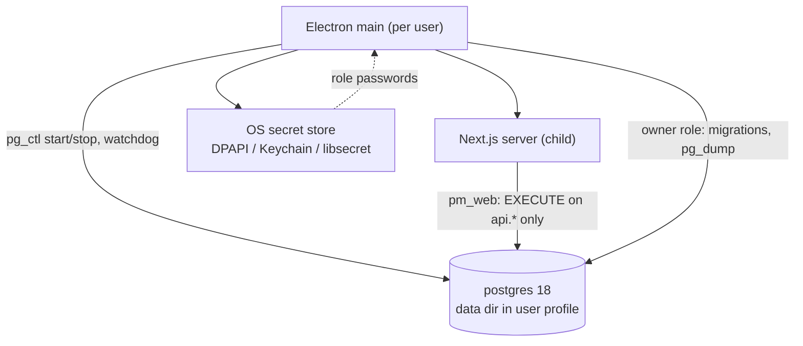

# ADR-0069: One embedded PostgreSQL for every desktop platform

- Status: Proposed (design only, no code yet)
- Date: 2026-11-17
- Module: platform (database, desktop runtime, release pipeline)
- Replaces, once accepted and cut over: the engine parts of ADR-0002, the mechanism (not the codes) of
  ADR-0012, ADR-0045, the mechanism of ADR-0033, the desktop backup part of ADR-0032. Touches ADR-0034
  (signing) and ADR-0003 (the action wrapper is unchanged).

## Context

The user decided on 2026-11-17 that the public beta must run as a local app on Windows and on macOS
("others where needed"), like today's Windows app. Today every install runs its own SQL Server Express,
and SQL Server has no macOS build (Azure SQL Edge, the last ARM option, was retired in 2025).

What the data layer is, measured on `develop` on 2026-11-17:

| Item | Count |
|---|---|
| Routine files in `db/procs` | 400 (381 procedures, 19 functions), 28,303 lines, 57 entity folders |
| Migrations in `db/migrations` | 75 (latest `078_meeting_point_assumption.sql`) |
| `THROW 5xxxx` sites (ADR-0012) | 1,314 in 327 files |
| `FOR JSON` / `OPENJSON` | 431 in 242 files / 107 in 38 files |
| `CROSS/OUTER APPLY` | 124 in 65 files |
| `@@ROWCOUNT` / `SCOPE_IDENTITY` / `OUTPUT` | 240 in 185 / 65 in 59 / 14 in 12 files |
| `rowversion` concurrency tokens | 64 in 63 files |
| Lock hints `UPDLOCK/HOLDLOCK/ROWLOCK/READPAST` / `sp_getapplock` | 190 in 133 files / 3 |
| `SYSUTCDATETIME`/`GETUTCDATE`, `DATEADD/DATEDIFF`, `TRY_CONVERT` | 243 / 34 / 55 |
| `MERGE`, `CURSOR`, `COLLATE`, temp tables | 7, 3, 14, 1 |
| Dynamic SQL, triggers, table-valued parameters, `SESSION_CONTEXT`, `PIVOT`, `hierarchyid` | none |

The code is static, set-based T-SQL with no dynamic SQL (ADR-0033 decision 5 forbids it). That makes a
dialect port mechanical for most lines; the risk sits in semantics, not syntax (see "Semantic traps").

The desktop runtime around the engine is Windows-only: `electron/setup/provision.ps1` (480 lines, runs
elevated: installs SQL Express as a service, loopback TCP, mixed-mode auth, firewall rule, service
recovery, ACLs on `%ProgramData%\Modulus`, publisher certificate), `electron/sql-service.ts`,
`electron/db-watchdog.ts`, `electron/db-apply.ts`, `electron/backup.ts` (`BACKUP DATABASE` +
`RESTORE VERIFYONLY`), `src/lib/files/scan.ts` (Defender `MpCmdRun` hook). The gateway
`src/lib/db.ts` (181 lines) uses `mssql`; `electron-builder.config.cjs` builds NSIS x64 only.

## Decision

### 1. One engine everywhere: PostgreSQL, embedded and started per user

PostgreSQL 18 (one pinned major; minor updates ride app releases) on Windows, macOS and Linux, and for
the server edition. Keeping SQL Server on Windows beside Postgres on Mac would mean writing and testing
every routine twice for the life of the product.

- **No service, no admin, no machine state.** Electron main runs `initdb` on first start and
  `pg_ctl start` on every start, as the signed-in user. `pg_ctl` is used (not `postgres` directly)
  because on Windows it drops administrator rights by itself, so an elevated start still works.
  The server lives as long as Electron main (tray included); `pg_ctl stop -m fast` on quit. A stale
  server from a killed app is detected with `pg_ctl status` and reused or restarted. Crash recovery is
  Postgres's own WAL replay. `electron/db-watchdog.ts` keeps its role (restart on exit, log, notice).
- **Data directory per user**, never in a synced folder: Windows `%LOCALAPPDATA%\Modulus\pgdata`,
  macOS `~/Library/Application Support/Modulus/pgdata`, Linux `$XDG_DATA_HOME/modulus/pgdata`, mode 0700.
  Uploads move beside it. This replaces the machine-wide `%ProgramData%\Modulus` and its ACLs.
- **Connections**: macOS and Linux listen on a Unix socket inside the data directory only
  (`listen_addresses = ''`), so other local accounts cannot even connect. Windows listens on
  `127.0.0.1` only, on a free port picked at start and handed to the Next.js child; `pg_hba.conf`
  allows `scram-sha-256` from loopback for the two roles and rejects everything else.
- **initdb settings**: `--encoding=UTF8 --locale-provider=builtin --builtin-locale=C.UTF-8` (no OS
  collation, so an OS update can never silently corrupt an index), data checksums on (18 default),
  `TimeZone = 'UTC'`, `jit = off` (no LLVM shipped), small memory settings sized for a laptop
  (`shared_buffers 128MB`, `max_connections 30`).
- **Binaries per OS/arch** (shipped under `resources/pg/<os>-<arch>/` with `bin`, `lib`, `share`;
  Postgres resolves `share` and `lib` relative to its own executable):

  | Target | Source | Notes |
  |---|---|---|
  | win-x64 (now) | EnterpriseDB "binaries only" zip, SHA-256 pinned | already EDB-signed; our installer signs ours |
  | mac-arm64, mac-x64 | built from the postgresql.org source tarball in our CI, SHA-256 pinned, `--with-icu --without-llvm`, install names rewritten to `@loader_path` | every Mach-O signed by us (section 8) |
  | linux-x64 | built from source on Ubuntu 22.04 (glibc floor) | AppImage and deb |
  | win-arm64, linux-arm64 | later, on request | x64 runs emulated on Windows on ARM |

  Prototyping may start from the relocatable builds published by `theseus-rs/postgresql-binaries`; the
  release builds are ours, so we control ICU, signing and the exact version.
- **ICU is bundled** with a pinned version for the case-insensitive collation (decision 4). On startup
  the app compares `pg_collation_actual_version` with the recorded version; on a change (only possible
  with our own release) it reindexes the affected indexes before the server opens to the app.

### 2. Roles: least privilege kept, by SECURITY DEFINER (replaces ADR-0033's mechanism)

SQL Server's ownership chaining has a direct Postgres equivalent:

- `modulus_owner` (bootstrap superuser from `initdb`) owns schemas `app`, `auth`, `audit`, `internal`,
  `api` and every table. Used only by Electron main for migrations, backups and the data move.
- `pm_web` (`LOGIN NOSUPERUSER NOCREATEDB NOCREATEROLE NOINHERIT`, member of `app_executor`) is what the
  Next.js server uses. `app_executor` gets `USAGE ON SCHEMA api` and `EXECUTE` on functions in `api`,
  nothing else: no table right, no `internal` access.
- Every `api` function is `SECURITY DEFINER`, owned by `modulus_owner`, with
  `SET search_path = pg_catalog, app, auth, audit, internal` pinned on the function (an unpinned path is
  the classic definer-hijack). Helpers (`ufn_*`) go to `internal`, callable only from definer code.
- Postgres grants `EXECUTE` on new functions to `PUBLIC` by default: the baseline runs
  `ALTER DEFAULT PRIVILEGES ... REVOKE EXECUTE ON FUNCTIONS FROM PUBLIC` and revokes `CREATE` on
  `public`.
- Passwords are random per install, stored with Electron `safeStorage` (DPAPI, Keychain, libsecret),
  never in a readable `machine.json`. The desktop now runs as `pm_web` too, which ADR-0033 decision 3
  skipped on the desktop.
- `db/verify/app_login.sql` gets a Postgres twin: as `pm_web`, fail on any table privilege, any function
  outside `api` being executable, any `api` function without a pinned `search_path` or not definer, and
  any role attribute beyond decision 2. A guardrail fails on `EXECUTE` (dynamic SQL) in any routine,
  the equivalent of today's `sp_executesql` ban.

### 3. Isolation: what replaces RCSI (replaces ADR-0045)

Postgres READ COMMITTED is multi-version by design: readers never block writers and see the last
committed version at statement start, which is what migration 042 bought on SQL Server. Nothing is
switched on and there is no `ALTER DATABASE` at startup. Locking intent is translated per hint
(decision 5) and proven by the ported race tests (`db/tests/*-race.cjs`). `lock_timeout` and
`statement_timeout` are set on `pm_web` to match the gateway's current request timeout;
`idle_in_transaction_session_timeout` guards leaked transactions.

### 4. Mapping procedures to PL/pgSQL functions

- **Every procedure becomes a FUNCTION** in schema `api` with the same name lowercased
  (`usp_Todo_GetDueAlerts` → `api.usp_todo_getduealerts`); the gateway lowercases, so no repository
  changes its call. Functions, not PROCEDUREs: a function returns rows directly and runs atomically in
  the caller's transaction; `BEGIN TRAN/COMMIT` and `SET XACT_ABORT ON` disappear (any error aborts).
  `execProcTx` / `withTransaction` keep their meaning: the gateway issues `BEGIN`/`COMMIT` around calls.
- **Parameters**: `@ActorUserId` → `p_actor_user_id`; the gateway calls with named notation
  (`api.f(p_actor_user_id => $1, ...)`), built only inside `src/lib/db.ts`. The no-inline-SQL guardrail
  stays and allows that one builder.
- **Results**: one row set → `RETURNS TABLE(...)` with **quoted PascalCase output names**
  (`"ProjectId"`), so every zod schema keeps working. Several row sets → `RETURNS jsonb` holding an array
  of row arrays, which the gateway turns into today's `recordsets`. `FOR JSON` payloads become
  `jsonb_build_object` / `jsonb_agg` with the same keys.
- **Tables and columns become snake_case** (`ProjectId` → `project_id`), a deterministic rename driven by
  a column map generated from the schema; only outputs keep PascalCase.
- **Types**: `int/bigint` → `integer/bigint` (`GENERATED BY DEFAULT AS IDENTITY`); `bit` → `boolean`;
  `nvarchar(n)/nvarchar(max)` → `varchar(n)/text`; `datetime2` (UTC) → `timestamptz`; `date` → `date`;
  `decimal(p,s)` → `numeric(p,s)`; `uniqueidentifier` → `uuid`; `varbinary` → `bytea`.
- **rowversion** → `row_ver bigint NOT NULL` filled from one database-wide sequence by one generic
  `BEFORE INSERT OR UPDATE` trigger, the only trigger allowed. Same semantics as `rowversion`
  (monotonic, changes on every write); `xmin` was rejected because it changes on dump/restore.
  The wire format the app sends and receives stays what it is today; the gateway converts.
- **Gateway type parsers** in `src/lib/db.ts` make `pg` return the same JS values `mssql` returns today:
  `int8` and `numeric` to `number` (as today), `date` to the same value `mssql` produces, `timestamptz`
  to `Date`. A gateway parity test pins each mapping.
- **Error contract (ADR-0012 codes unchanged)**: `THROW 50001, 'NOT_FOUND:msg', 1` →
  `RAISE EXCEPTION USING ERRCODE = 'MD001', MESSAGE = 'NOT_FOUND:msg'`. Registry: 50001-50007 ↔
  `MD001`-`MD007` (class `MD` is unused by Postgres); 50008+ register both numbers in ADR-0012. The
  gateway maps SQLSTATE `MD0xx` to `AppError { code }` exactly as it maps 50001-50999 today; any other
  error is `INTERNAL`, logged server-side only. A guardrail allows only registry codes in `RAISE`.
- **Construct table** (the translator's rules):

  | T-SQL | PostgreSQL |
  |---|---|
  | `@@ROWCOUNT` | `GET DIAGNOSTICS v_n = ROW_COUNT` / `FOUND` |
  | `SCOPE_IDENTITY()`, `OUTPUT inserted.*` | `RETURNING ... INTO` |
  | `CROSS APPLY` / `OUTER APPLY` | `CROSS JOIN LATERAL` / `LEFT JOIN LATERAL ... ON true` |
  | `TOP (n)`, `OFFSET/FETCH` | `LIMIT`, `OFFSET/LIMIT` |
  | `OPENJSON(@x) WITH (...)` | `jsonb_to_recordset` / `jsonb_array_elements` |
  | `FOR JSON PATH` | `jsonb_agg(jsonb_strip_nulls(jsonb_build_object(...)))` (FOR JSON omits NULL keys) |
  | `TRY_CONVERT(int, x)` | `CASE WHEN pg_input_is_valid(x, 'integer') THEN x::int END` |
  | `SYSUTCDATETIME()` | `clock_timestamp()` (statement-time, like T-SQL; `now()` is transaction-time) |
  | `DATEDIFF(day, a, b)` | `internal.datediff_day(a, b)` (counts boundaries like T-SQL) |
  | `MERGE` used as upsert | `INSERT ... ON CONFLICT` (Postgres MERGE is not race-safe for upsert) |
  | `CURSOR` loops | `FOR r IN SELECT ... LOOP` |
  | `UPDLOCK/ROWLOCK` on rows that exist | `SELECT ... FOR UPDATE` |
  | `HOLDLOCK` guarding a key that may not exist yet | unique constraint + `ON CONFLICT`, or `pg_advisory_xact_lock(<key>)` |
  | `READPAST` | `FOR UPDATE SKIP LOCKED` |
  | `sp_getapplock` | `pg_advisory_xact_lock` |
  | `STRING_AGG(x, ',') WITHIN GROUP (ORDER BY y)` | `string_agg(x, ',' ORDER BY y)` |

- **Semantic traps the translator must handle explicitly** (each one is a rule plus a parity test):
  1. SQL Server compares text case-insensitively by default. Every text column gets the ICU
     nondeterministic collation `ci` (`und-u-ks-level2`: case-insensitive, accent-sensitive, the
     `_CI_AS` match); unique indexes and `=`/`LIKE` then behave as today (LIKE on nondeterministic
     collations needs 18). Explicit `COLLATE` sites (14) are mapped one by one.
  2. `'a' = 'a '` is true in SQL Server (trailing spaces ignored), false in Postgres. Inputs are already
     trimmed by the zod schemas; the parity suite includes trailing-space cases for unique names.
  3. A SQL Server unique index allows one NULL; Postgres allows many. Unique indexes on nullable
     columns get `NULLS NOT DISTINCT` unless the source index was filtered on `IS NOT NULL`.
  4. `FOR JSON` drops NULL properties and returns NULL for no rows; the translation reproduces both.
  5. `node-pg` reads `timestamp without time zone` as local time; hence `timestamptz` + UTC only.
  6. Sorting with the `ci` collation differs from `_CI_AS` for some punctuation; ordered outputs used in
     the UI are compared in the parity suite, and stable tie-breakers (`, id`) are added where missing.

### 5. Migrations: one Postgres baseline, not 75 translations

The Postgres schema starts from `db/pg/migrations/000_baseline.sql`, generated from the final SQL Server
schema (after the last T-SQL migration at port start) by the schema converter, then reviewed by hand.
Later migrations are written for Postgres only. Between port start and cutover, a schema change must be
written for both engines; the beta's feature freeze keeps that rare. `app.SchemaMigrations` keeps its
role; the T-SQL history is not replayed on Postgres.

### 6. Translation and parity-test strategy

- **Tooling, not hand copying**: a translator (spike in phase 0 decides between `sqlglot` for statement
  bodies and an ANTLR `TSqlParser` grammar; our own rules handle the procedural shell, the construct
  table and the column map) emits one file per routine under `db/pg/routines/<entity>/`, marking what
  it could not translate with `-- PORT:` lines that fail the build until resolved. A manifest
  `db/pg/port-status.json` records each routine as `translated`, `parity-green` or `signed-off`.
- **Engine-neutral proc tests**: the 25 suites in `db/tests/*.cjs` get one driver interface
  (`callProc(name, params)`) with an `mssql` and a `pg` backend; CI runs every suite against both. A
  routine is ported when its suite passes on Postgres unchanged.
- **Differential replay** for coverage the suites lack: the full Playwright e2e run against SQL Server
  records every gateway call (routine, parameters, outcome) into a trace. A replay tool loads the same
  fixture into both engines, replays the trace on each, and compares after every call: the normalised
  result (rows, canonical JSON, error code) and per-table row counts and checksums. Any difference fails.
- **Coverage gate**: every one of the 400 routines appears in the suites or the trace with at least one
  success and one refused call; every routine's declared error codes are hit at least once, or listed
  with a reason.
- **Whole-app gate**: the full e2e suite green on Postgres on Windows and macOS runners; the race suites
  green; a performance check on the heaviest pages (workspace and register loads) within 1.5x of SQL
  Server on the same machine.
- **Gateway during the port**: `src/lib/db.ts` supports both engines behind `DB_ENGINE=mssql|pg` so
  Windows releases keep shipping on SQL Server. `mssql` stays only in the data mover after cutover and
  leaves when the last install has moved.

### 7. Backups and restore (replaces ADR-0032 decision 2 on the desktop)

- `electron/backup.ts` runs the bundled `pg_dump -Fc` (compressed, whole database) as `modulus_owner`
  into the user's backup folder (default inside the profile, user-selectable, e.g. OneDrive or iCloud
  Drive), with today's schedule, retention and reminder. No PowerShell and no SQL Agent on any OS.
- **Verification is stronger than `RESTORE VERIFYONLY`**: every backup is checked with
  `pg_restore --list`, and once a week the newest is restored into a scratch database and its per-table
  row counts compared with the live ones; a failure raises the backup notice.
- **Restore** loads into a new database with `pg_restore --single-transaction`, then swaps names, so a
  failed restore leaves the current data untouched.
- The server edition (Docker Compose) uses the official Postgres image and the same `pg_dump` set in
  `scripts/backup.sh`; WAL archiving is out of scope until a server customer needs point-in-time restore.

### 8. Mac build pipeline

- electron-builder `mac` targets `dmg` and `zip` (the zip feeds `electron-updater`), **one build per
  arch** (arm64 on `macos-15`, x64 on `macos-15-intel`) rather than universal: Postgres, Node and
  Next.js together would double the download for everyone.
- **Signing**: a Developer ID Application certificate (Apple Developer Program, organisation
  enrolment, needs a D-U-N-S number) imported into a temporary keychain from CI secrets. Every Mach-O
  under `resources/pg` is signed with `--options runtime --timestamp` before electron-builder signs the
  app with `hardenedRuntime: true`. Entitlements: Electron's `allow-jit` and
  `allow-unsigned-executable-memory` for V8 only; Postgres needs none.
- **Notarisation**: `notarytool submit --wait` with an App Store Connect API key (electron-builder
  `notarize`), then `stapler staple` on the dmg. Release gates: `spctl -a -vvv -t install`,
  `stapler validate`, `codesign --verify --deep --strict`.
- **Smoke test** on a clean macOS VM as a standard user: download with quarantine, open, first run
  creates the cluster, sign in, back up, restore, update to the next build.
- Windows keeps NSIS per-user; the bundled Postgres binaries are signed in the same Trusted Signing
  pass as the rest (plan section C). Linux: AppImage and deb, unsigned beyond a checksum.

### 9. Mac (and Linux) equivalents of the Windows-only parts

| Windows today | Mac / Linux | Windows after the port |
|---|---|---|
| `provision.ps1`, elevated: SQL Express, service, TCP, firewall, ACLs, publisher cert | Nothing to provision. First run: create the profile folders (0700), `initdb`, secrets into Keychain/libsecret. Optional "open at login" via `app.setLoginItemSettings`, no admin | Same as Mac. `provision.ps1` is kept only for old installs, and only for the optional removal of SQL Express after the move (needs admin, offered, never required) |
| `src/lib/files/scan.ts` → Defender `MpCmdRun` | No callable system scanner on macOS. Files the app writes out for the user (exports, opened attachments) get the `com.apple.quarantine` attribute so Gatekeeper checks them on open; if ClamAV is installed (`clamdscan`/`clamscan` on PATH) it is used. Linux: ClamAV if present | Unchanged (`MpCmdRun`) |
| `electron/backup.ts` via `BACKUP DATABASE`, scripts via PowerShell | `pg_dump` / `pg_restore` from Node (decision 7) | Same |
| `electron/sql-service.ts` (service start, recovery) | `pg_ctl` lifecycle in Electron main (decision 1) | Same |

The scanner keeps one interface in `scan.ts` with a per-OS adapter; the accepted risk on macOS without
ClamAV is written in DESKTOP.md (uploads are stored as data, never executed by the app).

### 10. One-time move of existing Windows installs from SQL Server to Postgres

Runs inside the first Postgres-capable build, which still carries the `mssql` path:

1. Start on SQL Server as today and apply the remaining T-SQL migrations (any old version updates
   straight to the newest, so the mover always reads the final T-SQL schema).
2. Show "Moving your data"; the app is read-only for the duration.
3. Full `BACKUP DATABASE ... WITH CHECKSUM` + `RESTORE VERIFYONLY` with today's `backup.ts`, kept as
   `pre-move_<stamp>.bak`. No backup, no move.
4. `initdb`, apply the Postgres baseline without foreign keys and secondary indexes.
5. Copy table by table in dependency order: stream rows from `mssql`, `COPY FROM STDIN` into Postgres,
   one transaction per table, ids with `OVERRIDING SYSTEM VALUE`, `rowversion` bytes to `bigint`.
6. Set identity and `row_ver` sequences above the copied maxima; create foreign keys and indexes (this
   re-proves integrity).
7. **Verify**: per-table row counts equal, and per-table checksums equal, computed in Node over a
   canonical text form of each row ordered by primary key on both sides (so neither engine's hashing
   is trusted). Then call a fixed set of read functions and compare with the same procs on SQL Server.
   Uploads are copied to the profile with a SHA-256 check.
8. On success: switch the machine config to `engine: "pg"` and tell the user the old database is kept.
   On any failure: drop the new cluster, keep running on SQL Server, log, retry on the next start.
9. **Keep the old database until the user confirms**, at the earliest after 7 days and 5 good starts.
   Until then "Go back to the old database" is offered (it warns that changes made since the move are
   lost). After confirmation the app drops its own database (`pm_app` owns it) and offers, but does not
   require, removing SQL Express with administrator approval.

The paying client's move happens only after a rehearsal on a copy of their database taken with their
permission, and after the same move has run on the beta testers' Windows installs.

### 11. Phased estimate (one builder; parallel lanes shorten phase 2)

| Phase | Content | Estimate | Exit criteria |
|---|---|---|---|
| 0. Spike | Embed on win-x64 and mac-arm64 (`initdb`, start/stop, roles, secrets); translator spike on 20 representative routines; `ci` collation and gateway type parity proven; notarise a test build with Postgres inside | 2-3 weeks | App signs in on a Mac on Postgres; 20 routines parity-green; notarised. Kill or re-plan if the translator automates under 50% of lines |
| 1. Foundations | Baseline schema converter, dual-engine gateway, engine-neutral test driver, trace recorder and replay tool, CI with a Postgres service | 2-3 weeks | Both engines in CI; replay diffing works |
| 2. Port | 400 routines module by module (auth and projects first), each module's suite and e2e green on Postgres | 6-9 weeks | Manifest all `signed-off`; coverage gate met |
| 3. Desktop runtime | Lifecycle and watchdog, `pg_dump` backups and verification, restore swap, data mover with checksums and rollback | 3-4 weeks (parallel to 2) | Mover rehearsed on three real-shaped databases |
| 4. Mac pipeline | Per-arch builds, signing, notarisation, update feed, scanner adapter, clean-VM smoke | 1-2 weeks (parallel) | Notarised dmg installs and updates on a clean Mac |
| 5. Hardening | Full e2e on Windows and macOS, race suites, performance check, clean-VM matrix (Windows 10/11 standard user, non-ASCII user name, OneDrive-redirected folders, third-party antivirus; macOS 13-15) | 2-3 weeks | All gates in decision 6 green |
| 6. Rollout | Postgres build to new beta installs, mover to beta testers, rehearsal and move for the client, Mac beta opens | 2 weeks + confirmation window | Client confirms; Mac beta live |

Total: about 16-24 builder-weeks, i.e. 4-6 months calendar for one builder, 3-4 months with the porting
lanes run in parallel. Apple enrolment and the Developer ID certificate start now (lead time).

### 12. What the Windows beta ships before the port lands

The Windows beta does not wait. It ships on today's SQL Server stack with plan sections A-D: licence
service and client, public code signing, the beta gate. Consequences accepted:

- Testers approve the one-time administrator prompt for SQL Server, as the plan's invite already says.
- Their installs later take the one-time move (decision 10), which is also its best rehearsal before the
  client's.
- Anything added during the port (the licence table of plan B, any fix that changes schema) is written
  for both engines; the feature freeze keeps that to a handful of changes.
- The Mac beta opens when phases 0-6 are done for macOS; Linux follows from the same build when asked.
  Phones and tablets stay out of scope.

## Alternatives considered

- **SQL Server on Windows, Postgres on Mac.** Every routine twice, parity drift forever. Rejected.
- **SQL Server in Docker/Podman on each Mac.** Needs Docker Desktop and x64 emulation on Apple Silicon.
  Rejected (plan E).
- **Babelfish for PostgreSQL** (runs T-SQL on Postgres). The only "no translation" path, but it needs a
  patched Postgres fork with no supported macOS or embeddable build, and its gaps would have to be found
  routine by routine anyway. Rejected.
- **SQLite in process.** Lightest to ship, no server, but no stored routines: 28k lines of logic would
  move into TypeScript, undoing ADR-0002's database-enforced rules, with a single writer. Rejected.
- **PGlite (Postgres compiled to WebAssembly, in process).** No separate process or port, runs
  PL/pgSQL, but single connection, slower, no ICU collation and a young project. Kept as the fallback if
  the native process model fails on real machines in phase 5.
- **Hosted app for Mac.** The user decided both must be local.

## Pre-mortem (the-fool, "find the failure modes")

Thesis, steelmanned: one embedded Postgres removes the only macOS blocker, the admin prompt on Windows
and the two-engine trap, and the code's static, set-based T-SQL makes the port mechanical enough to
prove routine by routine. It is 2027-06 and the port has failed. Why?

| # | Failure story | Early warning | Mitigation in this ADR |
|---|---|---|---|
| 1 | Parity looked green but behaviour differed: duplicate names that differ in case, new sort orders, a lost update where a `HOLDLOCK` range lock became a plain row lock | Diffs "normalised away" in the replay tool; race suites skipped on Postgres | Semantic-trap rules (decision 4), differential replay with no ignore list without review, race suites mandatory, coverage gate |
| 2 | The move damaged the paying client's data or cost them a week | Mover tested only on synthetic data; checksum step made optional "for speed" | Backup first, checksums both sides, old database kept with a way back, rehearsal on a copy of their database, testers moved first |
| 3 | The port ran to nine months while features kept landing in T-SQL, so the target kept moving | Schema changes during the port; phase 0 over 4 weeks; translator under 50% | Feature freeze, both-engine rule for schema changes, phase 0 kill criteria, Windows beta independent of the port |
| 4 | The embedded server failed on real PCs: antivirus locking WAL files, a non-ASCII profile path breaking `initdb`, sleep and resume, a full disk, a profile on a network share | Support reports mentioning "database did not start"; watchdog restarts in logs | Clean-VM matrix in phase 5, data dir never in a synced folder, watchdog with a diagnostics bundle, data checksums, PGlite fallback |
| 5 | The Mac build was blocked by Apple: enrolment stuck on D-U-N-S, notarisation rejecting unsigned nested Postgres binaries | No Developer ID by end of phase 0; first notarisation attempt in phase 4 | Enrol now; notarise a build with Postgres inside in phase 0 |
| 6 | A local attacker or another account reached the data: definer function hijacked through `search_path`, `PUBLIC` execute, a readable password file | Verify script not run in CI; secrets in plain JSON | Pinned `search_path`, default-privilege revoke, `pm_web` verify script in CI, OS secret store, Unix socket on Mac/Linux, loopback + SCRAM on Windows |

Inversion check, what would guarantee failure: translating by hand without the replay harness, moving
the client without a rehearsal, and keeping both engines in production for months. Each is ruled out
above.

Questions this pre-mortem leaves for the user. No answer came within 15 minutes, so under the standing
rule each default below is taken: defaults taken 2026-11-17, open to the user's change.

1. Data per Windows user instead of per PC? Default: per user (the move goes to the account that
   confirms it; other accounts on that PC see a notice).
2. Mac downloads per chip instead of one universal app? Default: per chip.
3. After a confirmed move, offer removal of SQL Server Express? Default: offer, never require.
4. Server edition moves to Postgres too? Default: yes, one engine.

## Consequences

- Positive: macOS and Linux become possible; no administrator prompt and no Windows service on any OS;
  least privilege now also on the desktop; one engine and one routine set; backups verified by a real
  restore; per-user data with no machine-wide ACLs.
- Negative: the largest piece of work in the plan (4-6 months); a semantic port with real traps; a
  both-engine period with a dual gateway; ICU and Postgres binaries to ship, sign and patch ourselves;
  the one-time move is the riskiest moment for the paying client.
- Neutral: zod schemas, repositories, actions and the UI do not change; ADR-0012's codes do not change.

## Verification (when built)

- Guardrails: every `db/procs` routine has an `api` twin until cutover; no dynamic `EXECUTE`; every
  `api` function definer with a pinned `search_path`; `RAISE` codes only from the registry.
- CI: both engines run the proc suites and the race suites; replay diff empty; Postgres verify script
  green; e2e green on Windows and macOS runners.
- Release: Mac notarisation gates (decision 8); clean-VM matrix (phase 5); mover rehearsal report with
  per-table counts and checksums attached to the release that carries it.
