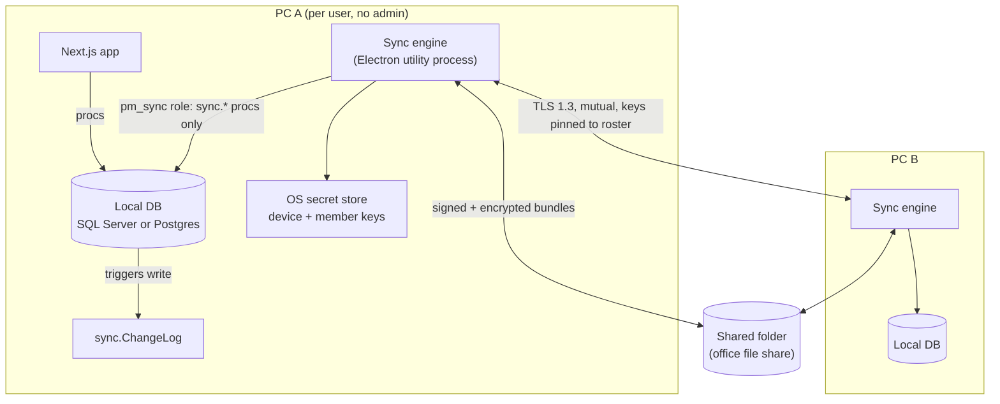

# ADR-0070: Offline team sync over the local network

- Status: Proposed (design only; nothing is built until the open questions at the end are answered)
- Date: 2026-11-18
- Relates to: ADR-0033 (least-privilege DB roles), ADR-0068 (licensing, Ed25519 signed documents),
  ADR-0069 (embedded PostgreSQL on every desktop platform)
- Scope: origin repository only

## Context

The client wants a team to work together with no server: PCs sync directly over the office network,
accounts and keys are created offline, data stays on each PC, and the same mechanism is reused by the
next application. No hosted service until a customer pays for one.

What the codebase gives us and what it rules out:

- Every PC already has its own database (SQL Server Express today; embedded PostgreSQL planned by
  ADR-0069). All data access goes through stored procedures (PL/pgSQL functions after the port).
- Entity tables use `INT IDENTITY` keys, soft delete (`IsDeleted`, `DeletedAtUtc`), audit columns and
  `RowVer ROWVERSION`. Integer keys collide across PCs, so they cannot be the identity of a row in sync.
- Users are standard Windows users: no admin, so no services, no machine-wide firewall rules, no
  driver installs. The same design must work on Mac.
- `auth.[User]` holds argon2id password hashes and login attempts. These must never leave the PC.
- Access levels and per-project permission overrides already exist (`app.ProjectPermissionOverride`).
- Node's built-in `crypto` has Ed25519, X25519, HKDF, ChaCha20-Poly1305 and TLS 1.3, so no new crypto
  dependency is needed.

Non-functional requirements: no data loss under concurrent edits (losers are kept, never discarded);
a peer that is offline for weeks must catch up; a PC that is lost or stolen must be removable; a
modified client must not be able to make other PCs accept changes its user is not allowed to make;
sync must keep working when PCs run different app versions for a while; teams of 2-25 PCs.

## Decision

### 1. Shape: a reusable sync kit plus a per-app manifest

- `packages/peer-sync`: a TypeScript package with no imports from `src/` (a guardrail test enforces
  it). It holds identity, roster, clocks, bundle format, signatures, encryption, conflict strategies,
  transports and discovery. It knows nothing about projects or requirements.
- Ports the package defines and each app implements: `ChangeStore` (read local changes since a
  version vector; apply a remote batch in one transaction), `KeyStore`, `Transport`, `Discovery`,
  `PolicyEngine` (may member M make change C?).
- Database adapters `peer-sync/mssql` and `peer-sync/postgres` generate the `sync` schema, the
  capture triggers and the apply procedures from the app's manifest. Two dialects, one generator,
  one test suite run against both engines.
- `src/sync/manifest.ts` (the app's only sync-specific code besides the policy) lists each synced
  table, its scope (which project a row belongs to), its foreign keys, and the conflict strategy per
  table or column. A second app writes its own manifest and policy and reuses everything else.
- The engine runs in an Electron utility process, not in the Next.js server, because it holds keys
  and sockets. It reaches the DB through a new `pm_sync` role that can execute only `sync.*`
  procedures (the ADR-0033 pattern; on Postgres, `SECURITY DEFINER` functions as in ADR-0069).

### 2. Unit of sharing: a team shares chosen projects

A **team** is a set of members and their devices. A project is either local (never leaves the PC)
or shared with the team; only members given a role on that project receive its rows. Lookup lists,
custom columns and other app-wide settings used by a shared project travel with it. Per-user
settings sync only between the same member's own devices. Auth tables, login attempts, licence
state and machine settings never sync.

### 3. Identity and keys, created offline

- **Member key**: Ed25519, generated on first use of sync from a 256-bit seed. The seed is shown once
  as a 24-word recovery phrase, which the user is told to print or write down. The seed is wrapped in
  the OS secret store (Electron `safeStorage`: DPAPI on Windows, Keychain on Mac) and never written
  in clear text.
- **Device key**: Ed25519 signing key plus an X25519 key for sealed boxes, generated per PC and kept
  in the OS secret store. The member key signs a **device certificate** (device public keys, member
  id, issued date). A member with two PCs has two device certificates.
- **Team**: created offline by its founder. The genesis record (team id, founder member key) is
  signed by the founder. Every change to the roster (add member, add device, change role, revoke) is
  a signed record in a hash-linked **roster log**; each PC rebuilds the roster by verifying the log
  from genesis. Founders and admins sign roster records; nobody else can.
- **Local login is unchanged**: people still sign in to their own PC with the existing account and
  password. The member key links that local account to the team; the password never syncs.
- **Joining**: an admin creates an invitation (team id, the admin's key fingerprint, a one-time 128-bit
  secret, expiry 24 hours) shown as a QR code and an 8-group text code. The joiner's PC connects to
  the admin's PC, both prove knowledge of the secret inside the TLS session (HMAC over the session's
  exported keying material), the joiner sends its member and device keys, and the admin's PC signs
  the roster record. The admin confirms the joiner's name and key fingerprint on screen.
- **Lost or stolen PC**: any admin revokes that device certificate. The revocation names the last
  change sequence accepted from that device; later changes from it are rejected everywhere. Project
  keys are rotated (section 5).
- **Forgotten local password**: unchanged local reset; the member key is unwrapped from the OS store
  for the same OS user, or restored from the recovery phrase.
- **Lost recovery phrase and all devices**: the member is re-added by an admin as a new key bound to
  the same member id (signed "rebind" record). Their past changes stay attributed to them.
- **Lost admins**: a team must have at least two admins before a third member can join (the app
  enforces it). If every admin is lost, the team cannot change its roster; members keep syncing data,
  and a new team can be founded and projects re-shared to it. This limit is stated in the app.

### 4. Sync model: signed per-device change log, field-level merge

A full CRDT document store (Automerge, Yjs) was rejected: it would move data out of the relational
schema and the procedures. Database-native replication was rejected: SQL Server merge replication
needs a publisher and admin rights, and nothing equivalent exists across both engines.

- **Global ids**: every synced table gets `GlobalId` (UUIDv7, `UNIQUEIDENTIFIER` / `uuid`), unique,
  set on insert. Local `INT IDENTITY` keys and local foreign keys stay as they are, so no existing
  procedure, URL or screen changes. The sync layer translates foreign keys to and from global ids
  using the manifest.
- **Capture**: generated `AFTER INSERT/UPDATE` triggers write one row per change to `sync.ChangeLog`:
  global id, table, changed columns with new values, hybrid logical clock (HLC) timestamp, device
  sequence number, acting member. The acting member comes from `SESSION_CONTEXT` (SQL Server) or
  `set_config` (Postgres), set by the action wrapper. Triggers cover every existing and future write
  procedure without editing them, and they also catch edits made directly in the database, which are
  then signed as that member's changes and checked by every other PC (section 6).
- **Per-device log**: each device numbers its changes 1, 2, 3... and seals them in batches whose
  header holds the previous batch hash and an Ed25519 signature by the device key. Two different
  batches with the same device and sequence number prove a forked or cloned device: the device is
  frozen until an admin decides.
- **Exchange**: peers swap version vectors (highest sequence seen per device) and send what the other
  is missing, for the projects the other may read. Any PC can relay any device's signed batches, so
  changes reach a PC that was never online at the same time as their author.
- **Apply**: the engine verifies signature, roster and permission, then calls generated apply
  procedures in one transaction per batch. Apply is idempotent (re-applying a batch changes nothing)
  and sets a session flag so the capture triggers do not log remote changes as local ones. A change
  whose parent row has not arrived yet waits in `sync.PendingChange` and is retried after each batch.

Conflict rules (each is a named strategy in the kit; the manifest picks one per table or column):

| Data | Strategy |
|---|---|
| Ordinary fields (titles, statuses, dates, amounts) | Field-level last writer wins by HLC, ties by device id. Two people editing different fields of the same row both keep their edit. |
| Rich text fields | Last writer wins, and the losing version is saved as a conflict copy in the row's history, with a notice "Edited on two PCs" on the row. No text is ever lost. |
| Link tables (assignees, participants, governance links, dependencies) | Add-wins set: link id = UUIDv5 of the two global ids, so concurrent adds merge; a remove only removes the adds it has seen. |
| Ordered lists (rows, cards, columns, agenda items) | Fractional position keys instead of integer sort numbers, ties by global id. Concurrent moves never collide. |
| Trees and dependency graphs (WBS, sub-requirements, milestone dependencies) | Field rule on the parent or link, then a cycle check after each batch; the move with the later HLC is undone and flagged. |
| Natural-key uniqueness (lookup list names, codes) | Lookup values merge by name; other duplicates are kept and the later one is renamed with " (2)". |
| Audit, meeting minutes history, financial transactions | Append-only: union by global id, never updated in place. Totals are always computed, never stored. |
| Deletes | Soft delete is a tombstone with an HLC. Delete wins over concurrent field edits (the edits are kept in history); an explicit restore with a later HLC wins over the delete. Tombstones are never purged in the first version. |
| Attachments | Content-addressed (SHA-256) files fetched on demand from any peer that has them, encrypted with the project key; size cap per file. |

**Schema-version skew**: every batch carries the protocol version and the sender's schema version
(latest migration number). Peers with a different protocol major version do not exchange data and
the app says which one needs updating. Within a protocol version, changes are field-level, so an older
PC never overwrites a column it does not know. Changes for tables or columns an older PC does not have
are stored unapplied, relayed to others, and applied after it updates. Migrations to synced tables
must be additive (add a column, backfill, keep the old one for at least two releases); a guardrail
test fails on a rename or drop of a synced column.

### 5. Transport security

- **Direct LAN**: TLS 1.3 with mutual authentication, using Node's built-in `tls`. Each device presents
  a self-signed certificate over its device key. Certificate authorities are not used; instead one
  tested function checks that the peer's key is a current, unrevoked device in the roster of the team
  being synced, and closes the connection otherwise. Certificates are never accepted on first use
  without an invitation.
- **Shared folder and file bundles**: each batch is signed by the device and encrypted with
  XChaCha20-Poly1305 (or ChaCha20-Poly1305 with a random 96-bit nonce per batch) under the project's
  data key. Project data keys are random 256-bit keys, sealed to each member device's X25519 key.
  Removing a member or device rotates the key for every project they could read; they keep what they
  already had and receive nothing new.
- **Limits**: frame size cap, per-peer rate limit, connection timeout, max pending changes; malformed
  input closes the session and is logged.

### 6. Permissions without a server

Every PC enforces the rules on what it receives. The app's `PolicyEngine` applies the same access
levels and project permission overrides the app already uses, evaluated against the roster and
permission state as the author's batch claims to have known it (its version vector), and never later
than a revocation that names the author's cut-off sequence. A change the author was not allowed to
make is not applied; it is quarantined in `sync.RejectedChange` with the reason and shown to admins.
A modified client can still write to its own database, but no other PC accepts it. Read access is
enforced by not sending a project's rows, or its key, to members without a role on it. Admin roster
conflicts are settled deterministically: a revocation by an earlier-added admin wins over a concurrent
one by a later-added admin, and the founder wins over all.

### 7. Discovery

- DNS-SD over mDNS (`_modulus-sync._tcp`), advertising only a rotating tag
  (HMAC of the team id with the date), never the team or member names.
- Manual "connect to address" for networks that block multicast or span subnets.
- The shared folder doubles as discovery: each device writes its current address there.

### 8. Audit

Each applied remote change writes to the existing audit trail with the author member, device, HLC and
batch hash. Sync sessions (peer, time, changes sent and received, rejects) are logged locally.
Rejected changes, forked devices, revocations and key rotations are visible to admins on a Sync
activity page. Signed hash chains make a member's changes attributable to their device key.

### 9. Phasing (one builder; sizes relative)

0. Spike, before anything else: on a standard Windows user, does a listening socket get blocked by
   the firewall prompt; does mDNS work on the client's network; does `safeStorage` work for a
   standard user. Result decides whether direct LAN or the shared folder is the main path. (S)
1. Kit core, member and device keys, team, roster log, recovery phrase, invitation over a file. (L)
2. `GlobalId` columns, capture triggers, apply procedures from the manifest, file-bundle sync of one
   project between two PCs end to end. (XL)
3. Shared folder transport, direct LAN TLS, discovery. (L)
4. Permission enforcement on receive, revocation, key rotation, Sync activity page. (L)
5. Attachments, conflict notices, fractional ordering for every ordered list. (L)

## Alternatives considered

- **Hosted relay or sync service**: simplest and reaches remote staff, but it is the SaaS the client
  wants to avoid until someone pays. The bundle format allows one to be added later as another
  transport.
- **CRDT document store (Automerge, Yjs)**: best merge quality for text, but moves data out of the
  procedures and the relational schema, and doubles storage. Kept as an option for rich-text fields
  only, later.
- **SQL Server merge replication / Postgres logical replication**: needs admin rights, a publisher,
  and differs per engine.
- **Whole-database sync**: simpler scoping, but sends every private project to every PC and makes
  read permissions impossible to enforce.
- **Noise protocol instead of TLS**: a cleaner fit for key-pinned peers, but needs a third-party
  implementation; TLS 1.3 in Node's own OpenSSL is audited and already shipped.
- **Changing every primary key to a UUID**: one identity everywhere, but touches every procedure,
  URL, screen and test. Global ids alongside local keys keep the blast radius inside the sync layer.

## Pre-mortem (the-fool, "find the failure modes"), most likely first

| # | Failure | Mitigation in this design |
|---|---|---|
| 1 | The Windows firewall blocks inbound connections for standard users, so two PCs never connect directly. | Phase 0 spike; the shared-folder transport needs only outbound file access; a direct link needs one side reachable, not both. |
| 2 | Peers are rarely online at the same time, so data drifts for days. | Store-and-forward through any peer and the shared folder; "last synced with" shown per member. |
| 3 | A long description edited on two PCs loses one person's text. | Conflict copy kept in history plus a visible notice; never silent. |
| 4 | One PC runs an old version and corrupts or drops new columns. | Field-level changes, unapplied storage of unknown changes, additive-only migrations guardrail, protocol version gate. |
| 5 | The only admin loses their PC and phrase; nobody can add or remove members. | Two admins required before a third member; recovery phrase at creation; documented limit. |
| 6 | A removed member's PC keeps sending backdated changes. | Revocation names the cut-off sequence; HLC is never trusted for authorization. |
| 7 | Integer sort orders and unique codes collide after merges. | Fractional keys, deterministic rename, cycle checks. |
| 8 | Triggers slow down every save on large projects. | Triggers write one narrow row; measured in phase 2 against the largest test project; batch size cap. |

Full failure narratives and the STRIDE threat model are kept in the lane notes for this design.

## Consequences

- Positive: no server, no admin rights, works on both engines, a second app reuses the kit with its own
  manifest; existing procedures, keys and screens are untouched.
- Negative: every synced table gains a `GlobalId` and a trigger; ordered lists move to fractional keys;
  migrations to synced tables become additive-only; tombstones grow without bound in version one; a
  removed member keeps the data they already had (true of any offline design).
- Operational: support must handle "PC X has not synced since...", forked devices and lost admins;
  the Sync activity page is the first tool for that.

## Verification (when built)

- Kit unit tests: roster verification, signature and hash-chain checks, each conflict strategy with
  concurrent cases, version-vector exchange, revocation cut-off.
- Both engines: trigger capture and apply round trip for every synced table, generated from the
  manifest (a manifest entry without a test fails the guardrail).
- Three-PC simulation in-process: random concurrent edits, partitions and relays converge to the same
  rows on every PC.
- Rejection tests: unsigned batch, wrong team, revoked device, member without rights, forked
  sequence, oversized frame; each is refused and audited.
- Skew test: an older-schema peer relays and later applies a newer peer's changes.

## Open questions (asked of the user 2026-11-18; defaults apply after 15 minutes)

1. First transports: direct LAN plus shared folder (default), direct LAN only, or shared folder and
   file bundles only.
2. Unit of sharing: chosen projects (default) or the whole database.
3. Sequencing: build after the PostgreSQL port lands (default), or now on SQL Server.
4. Recovery: recovery phrase plus at least two admins (default), or admin re-issue only.
