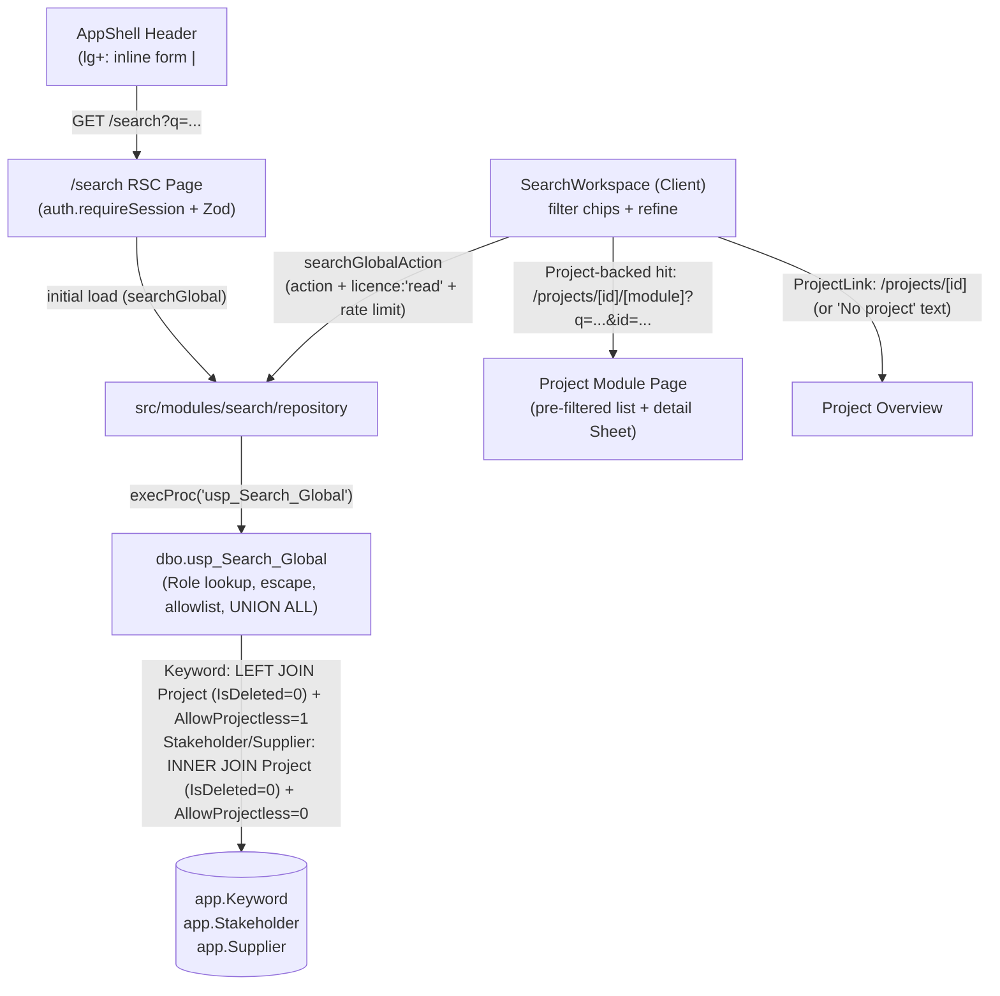

# ADR-0073: Global search across projects

- Status: Accepted (USER approved 2026-11-27)
- Date: 2026-11-27
- Modules: `search` (new), `shell`, `keywords`, `stakeholders`, `suppliers`
- Builds on: ADR-0001, ADR-0002, ADR-0003, ADR-0012, ADR-0016, ADR-0021, ADR-0024, ADR-0040, ADR-0068

## 1. Context

Every project currently holds its own Keywords (`/projects/[id]/keywords`), Stakeholders (`/projects/[id]/stakeholders`), and Suppliers (`/projects/[id]/suppliers`) registers. Client feedback asked for a way to search across **all accessible projects** for keywords, stakeholders, suppliers, and future entities rather than opening projects one by one.

Today:
- `usp_Keyword_List`, `usp_Stakeholder_List`, and `usp_Supplier_List` support `@ProjectId = NULL` at the stored-procedure level, **but** they have cross-project gaps and no cross-project UI:
  1. None of those three list procs join `app.Project` to check `p.IsDeleted = 0`, so records belonging to soft-deleted projects remain visible through `ufn_AccessLevel_Resolve` (which checks `app.ProjectAssignee`, not `app.Project.IsDeleted`).
  2. There are **no global routes** `/keywords`, `/stakeholders`, or `/suppliers` in `src/app/(app)/`. Only `/projects/[id]/<module>` exists, and every project page guards `?id=<id>` with `guardProjectScope(selectedRaw, projectId)` (`entity.ProjectId === projectId`). Yet `app.Keyword.ProjectId` is nullable and three seeded keywords (`KeywordId` 19, 21, 23) have `ProjectId IS NULL`.
  3. Existing `usp_*_List` procs escape `@Search` in place inside `NVARCHAR(100)`, which silently truncates if metacharacters expand beyond 100 characters.
  4. `usp_Stakeholder_List` did not match full-name phrases (`FirstName + ' ' + LastName`) or `ProjectRole`, and `usp_Supplier_List` did not match `EmailAddress`.

Non-functional constraints:
- **Zero data disclosure:** A user must never see records, counts, or existence hints from projects they cannot read or projects that are soft-deleted (`p.IsDeleted = 0`).
- **One round trip, bounded cost:** Searching one entity kind with many matches must not starve other kinds or trigger N+1 lookups.
- **Mobile 375px header integrity:** Adding search to the app shell header must not overflow `375px` viewports or break `e2e/shell.spec.ts` / Axe accessibility checks.
- **Read-only licence compatibility:** Search performs no mutations and must keep working when a licence/trial is inactive (`licence: "read"` per ADR-0068).

## 2. Architecture Overview



Layer placement (per ADR-0001 / `clean-architecture`):
- `db/procs/search/usp_Search_Global.sql`: Single stored procedure enforcing role lookup, access filtering, soft-delete filtering, escaping, kind allowlist validation, and per-kind caps.
- `db/procs/stakeholder/usp_Stakeholder_List.sql` & `db/procs/supplier/usp_Supplier_List.sql`: Updated in lockstep with `usp_Search_Global` to support the widened searchable columns (`FirstName + ' ' + LastName`, `ProjectRole`, and supplier `EmailAddress`) so `?q=<q>&id=<id>` hand-offs keep matching rows visible.
- `src/modules/search/schemas/search.ts`: Pure Zod input/output schemas, constants (`SEARCH_KINDS`, `SEARCH_MIN_LENGTH`, `SEARCH_MAX_LENGTH`, `SEARCH_DEFAULT_TOP_PER_KIND`, `SEARCH_MAX_TOP_PER_KIND`), and the search kind registry (`SEARCH_KIND_REGISTRY`).
- `src/modules/search/repository/search.ts`: Calls `execProc("usp_Search_Global", ...)` and maps proc rows through `SEARCH_KIND_REGISTRY` into validated `SearchHit` DTOs with server-constructed relative `href`s (or `null` for projectless keywords).
- `src/modules/search/actions/index.ts`: Exports `searchGlobalAction` built with `action({ ..., licence: "read" })`.
- `src/app/(app)/search/page.tsx` + `src/modules/search/components/`: Server page + client search workspace grouped by kind.
- `src/components/shell/`: Responsive header search control (`header-actions.tsx` / `app-shell.tsx`) and `pageTitleFor("/search")` in `nav-items.ts`.

## 3. Decision

### 3.1 Phase 1 Scope and Widened Searchable Columns

Phase 1 covers the three requested registers: `keyword`, `stakeholder`, and `supplier`.

Per USER approval (2026-11-27), Stakeholder and Supplier search is **widened** in both `usp_Search_Global` and the underlying `usp_Stakeholder_List` / `usp_Supplier_List` procs so global hits and `?q=<q>&id=<id>` destination lists stay 100% consistent:

| Kind (`kind`) | Table (`IsDeleted = 0`) | Exact Searched Columns (Synced Across Global + List Procs) | Result `title` | Result `snippet` (Plain Text) | Destination Route (`href`) |
|---|---|---|---|---|---|
| `keyword` | `app.Keyword` | `Keyword` (`NVARCHAR(255)`), `Definition` (`NVARCHAR(255)`) | `Keyword` | `Definition` (nullable) | `/projects/<projectId>/keywords?q=<q>&id=<id>` when `projectId !== null`; `null` when `projectId === null` |
| `stakeholder` | `app.Stakeholder` | `FirstName` (`NVARCHAR(255)`), `LastName` (`NVARCHAR(255)`), full name (`CONCAT(FirstName, CASE WHEN LastName IS NOT NULL AND LastName <> N'' THEN N' ' + LastName ELSE N'' END)`), `ProjectRole` (`NVARCHAR(255)`), `DepartmentOrganization` (`NVARCHAR(255)`), `EmailAddress` (`NVARCHAR(255)`) | `FirstName` + optional `' ' + LastName` | Compact join of `ProjectRole`, `DepartmentOrganization`, `EmailAddress` (non-empty parts separated by `" · "`) | `/projects/<projectId>/stakeholders?q=<q>&id=<id>` |
| `supplier` | `app.Supplier` | `SupplierName` (`NVARCHAR(255)`), `ContactPerson` (`NVARCHAR(255)`), `EmailAddress` (`NVARCHAR(255)`), `City` (`NVARCHAR(255)`) | `SupplierName` | Compact join of `ContactPerson`, `City`, `Rating` (non-empty parts separated by `" · "`) | `/projects/<projectId>/suppliers?q=<q>&id=<id>` |

Note on intentional scope boundary:
- **Custom register columns (`app.KeywordCell`, `app.SupplierCell`)** remain out of scope for Phase 1.

### 3.2 Extensibility Registry for Future Modules ("etc.")

The TypeScript module defines one canonical ordered registry (`SEARCH_KIND_REGISTRY`) keyed by `kind`:

```ts
export const SEARCH_KINDS = ["keyword", "stakeholder", "supplier"] as const;
export type SearchKind = (typeof SEARCH_KINDS)[number];
```

Each entry holds:
- `kind`: closed enum key matching SQL `Kind` literal (`"keyword" | "stakeholder" | "supplier"`).
- `label`: label resolver from `messages.search.kinds` (never hardcoded UI strings).
- `routeSegment`: destination module segment (`"keywords" | "stakeholders" | "suppliers"`).
- `buildHref(projectId, id, query)`: returns `null` when `projectId === null` (only valid for kinds supporting projectless records like `keyword`), otherwise builds a safe relative path using positive-integer validation and `encodeURIComponent(query)`.

**Extension-scenario test (adding a 4th module, e.g. `decision`):**
1. Add one `SELECT TOP (@TopPerKind)` branch + `'decision'` token in `usp_Search_Global.sql`'s allowlist.
2. Add `"decision"` to `SEARCH_KINDS`, one entry in `SEARCH_KIND_REGISTRY`, and one key in `messages.search.kinds`.
3. Add regression cases in `db/tests/global-search-procs.cjs` and unit tests.
No changes to `searchGlobalAction`, `repository/search.ts` query plumbing, `SearchWorkspace` grouping loop, or shell header are required.

### 3.3 Result Shape and API Contract

#### Server Action & Repository Output DTO

Every search hit maps to a single normalized shape (`projectId`, `projectName`, and `href` are `null` only for projectless keywords):

```ts
export interface SearchHit {
  kind: SearchKind;
  id: number;
  projectId: number | null;
  projectName: string | null;
  title: string;
  snippet: string | null;
  href: string | null;
}

export interface SearchKindGroup {
  kind: SearchKind;
  hits: SearchHit[];
  hasMore: boolean;
}

export interface GlobalSearchResult {
  query: string;
  groups: SearchKindGroup[];
}
```

Validation invariant on `SearchHit` mapping:
- If `projectId !== null`: `projectId` must be a positive integer, `projectName` must be a non-empty string, and `href` is constructed via `SEARCH_KIND_REGISTRY[kind].buildHref(projectId, id, query)`.
- If `projectId === null`: only permitted when `kind === "keyword"`; `projectName` is `null` and `href` is `null` (fails Zod parse if a non-keyword row ever reports `ProjectId IS NULL`).

Why `hasMore` per group:
- The repository requests `topPerKind + 1` (e.g., `26` when UI cap is `25`, within the proc's max `50`) and slices each kind to `topPerKind` (`25`), setting `hasMore = rawCount > topPerKind`.
- This accurately distinguishes "exactly 25 matches exist" from "more than 25 matches were capped — refine search", without adding a separate `COUNT(*)` scan across all rows.

#### Action Contract (`src/modules/search/actions/index.ts`)

```ts
export const globalSearchInput = z.object({
  q: z.string().trim().min(2).max(100),
  kinds: z.array(z.enum(SEARCH_KINDS)).min(1).max(SEARCH_KINDS.length).optional(),
  topPerKind: z.number().int().min(1).max(25).default(25),
});
```

- Named **`searchGlobalAction`** so `src/tests/licence-write-guard.test.ts` matches `^export const ((?:list|read|search)\w*Action)` and enforces `licence: "read"`.
- Wrapped via `action({ name: "search.global", schema: globalSearchInput, permission: "projects:read", licence: "read", handler })`:
  - Authenticates via `auth.requireSession()` (never trusts client `userId` or `role`).
  - Throttles via `takeUserSlot("actions", session.userId)` (240 requests/minute per user, ADR-0031).
  - Validates `q`, `kinds`, and `topPerKind` via Zod before touching the DB.
  - Passes global RBAC `can(session.role, "projects:read")` (allows `Admin` and `User`).
  - Bypasses `refuseIfReadOnly()` via `licence: "read"` so global search stays functional when a licence/trial is inactive.
  - Maps any proc `THROW 50003`/`50004` (`FORBIDDEN_ROW` / `VALIDATION`) and action `RATE_LIMITED` / `INTERNAL` (with opaque reference ID) cleanly per ADR-0003 and ADR-0012.

#### SSR Page Route (`/search`)

- `src/app/(app)/search/page.tsx` reads `searchParams` (`q`, optional comma-separated `kinds` filtered safely against `SEARCH_KINDS`):
  - If `q` is absent or `< 2` trimmed characters: **does not call the proc**; renders the empty/minimum-length prompt (`"Enter at least 2 characters to search."`).
  - If `q` is `>= 2` characters (max 100): calls `searchGlobal(...)` server-side under `auth.requireSession()` and passes initial `GlobalSearchResult` to `SearchWorkspace`.
  - Page renders per-session via `auth.requireSession()` (never statically cached across users).

### 3.4 Stored Procedure Design (`db/procs/search/usp_Search_Global.sql`)

#### Signature

```sql
CREATE OR ALTER PROCEDURE dbo.usp_Search_Global
    @ActorUserId INT,
    @Search      NVARCHAR(100),
    @Kinds       NVARCHAR(200) = NULL,
    @TopPerKind  INT           = 25
```

#### Step-by-Step Behaviour

1. **Resolve actor role from DB (never trust caller):**
   ```sql
   DECLARE @ActorRole NVARCHAR(50);
   EXEC dbo.usp_User_GetActorRole @UserId = @ActorUserId, @Role = @ActorRole OUTPUT;
   ```
   Rejects unknown, inactive, or deleted users with `THROW 50003, N'FORBIDDEN_ROW:...', 1`.

2. **Normalize and validate `@Search` (>= 2 chars) + safe escaping into `NVARCHAR(200)`:**
   ```sql
   SET @Search = NULLIF(LTRIM(RTRIM(@Search)), N'');
   IF @Search IS NULL OR LEN(@Search) < 2
       THROW 50004, N'VALIDATION:Search term must be at least 2 characters', 1;

   DECLARE @Escaped NVARCHAR(200) =
       REPLACE(REPLACE(REPLACE(REPLACE(@Search, N'\', N'\\'), N'%', N'\%'), N'_', N'\_'), N'[', N'\[');
   ```
   - Escapes `\` **first**, then `%`, `_`, `[`.
   - Assigns into **`@Escaped NVARCHAR(200)`** (not `@Search NVARCHAR(100)`) so an input of up to 100 metacharacters (e.g. 100 `%` signs -> 200 escaped chars) never truncates mid-escape sequence and never raises a T-SQL `ESCAPE` syntax error from a dangling trailing `\`.
   - Uses `N'%' + @Escaped + N'%' ESCAPE N'\'` on every `LIKE` predicate.
   - **Guardrail note for Slice 1 (`src/tests/list-search-escape.test.ts`):** `list-search-escape.test.ts` currently matches `LIKE` lines containing `@Search` directly. Because `usp_Search_Global` uses `@Escaped NVARCHAR(200)` in `LIKE` to avoid 100-char truncation, Slice 1 must also extend `list-search-escape.test.ts` (and add `src/tests/search-sql-guardrails.test.ts`) so `@Escaped`-backed `LIKE` predicates are verified automatically rather than skipped vacuously.

3. **Clamp `@TopPerKind`:**
   ```sql
   SET @TopPerKind = CASE
       WHEN @TopPerKind IS NULL OR @TopPerKind < 1 THEN 25
       WHEN @TopPerKind > 50 THEN 50
       ELSE @TopPerKind
   END;
   ```

4. **Strict `@Kinds` allowlist validation (no dynamic SQL):**
   - If `@Kinds IS NULL` or `NULLIF(LTRIM(RTRIM(@Kinds)), N'') IS NULL`, enable all three kinds (`@IncludeKeyword = 1`, `@IncludeStakeholder = 1`, `@IncludeSupplier = 1`).
   - Otherwise, split `@Kinds` with `STRING_SPLIT(..., N',')`, normalize with `LOWER(LTRIM(RTRIM([value])))`, and validate every token against `(N'keyword', N'stakeholder', N'supplier')`. Any unknown or empty token throws `50004, N'VALIDATION:Invalid search kind', 1`.
   - Set `@IncludeKeyword`, `@IncludeStakeholder`, `@IncludeSupplier` bits accordingly.

5. **Access control & `p.IsDeleted = 0` per branch:**
   - **Keyword branch (`app.Keyword` — nullable `ProjectId`):**
     - `LEFT JOIN app.Project p ON p.ProjectId = k.ProjectId`
     - `CROSS APPLY dbo.ufn_AccessLevel_Resolve(@ActorRole, @ActorUserId, k.ProjectId, 1) acc` (`@AllowProjectless = 1`)
     - `WHERE @IncludeKeyword = 1 AND k.IsDeleted = 0 AND (k.ProjectId IS NULL OR p.IsDeleted = 0) AND acc.AccessLevel IS NOT NULL`
     - Note: If `k.ProjectId` points to a soft-deleted project (`p.IsDeleted = 1`), `(k.ProjectId IS NULL OR p.IsDeleted = 0)` is FALSE and excludes the row even for `Admin`. If `k.ProjectId IS NULL`, `p.ProjectId` and `p.ProjectName` are `NULL` and `@AllowProjectless = 1` resolves `'Contributor'` / `'Manager'` so every active user can search shared projectless keywords (matching `usp_Keyword_List`).
   - **Stakeholder & Supplier branches (`ProjectId NOT NULL`):**
     - `INNER JOIN app.Project p ON p.ProjectId = e.ProjectId AND p.IsDeleted = 0`
     - `CROSS APPLY dbo.ufn_AccessLevel_Resolve(@ActorRole, @ActorUserId, p.ProjectId, 0) acc` (`@AllowProjectless = 0`)
     - `WHERE @Include* = 1 AND e.IsDeleted = 0 AND acc.AccessLevel IS NOT NULL`
   - Per ADR-0021 and ADR-0024:
     - `Admin` resolves to `Manager` on all active (`p.IsDeleted = 0`) projects.
     - `User` resolves only to projects where they have an active `app.ProjectAssignee` row (`Viewer`, `Contributor`, or `Manager`). Per-person `ProjectPermission` overrides never revoke `read` (`OVERRIDABLE_MODULES` in `rbac.ts`), so `acc.AccessLevel IS NOT NULL` is exact.
     - Non-members receive **zero rows** (no count, no existence leak).

6. **Per-kind `SELECT TOP (@TopPerKind)` combined with `UNION ALL`:**
   - T-SQL requires each `TOP (@TopPerKind) ... ORDER BY ...` branch in a `UNION ALL` to be wrapped in its own derived subquery so one `ORDER BY` does not conflict with `UNION ALL`:
   ```sql
   SELECT Kind, Id, ProjectId, ProjectName, Title, Snippet
   FROM (
       SELECT TOP (@TopPerKind)
              N'keyword'     AS Kind,
              k.KeywordId    AS Id,
              p.ProjectId    AS ProjectId,
              p.ProjectName  AS ProjectName,
              k.[Keyword]    AS Title,
              k.[Definition] AS Snippet
       FROM app.Keyword k
       LEFT JOIN app.Project p ON p.ProjectId = k.ProjectId
       CROSS APPLY dbo.ufn_AccessLevel_Resolve(@ActorRole, @ActorUserId, k.ProjectId, 1) acc
       WHERE @IncludeKeyword = 1
         AND k.IsDeleted = 0
         AND (k.ProjectId IS NULL OR p.IsDeleted = 0)
         AND acc.AccessLevel IS NOT NULL
         AND (k.[Keyword] LIKE N'%' + @Escaped + N'%' ESCAPE N'\'
              OR k.[Definition] LIKE N'%' + @Escaped + N'%' ESCAPE N'\')
       ORDER BY
           CASE WHEN k.[Keyword] = @Search THEN 0
                WHEN k.[Keyword] LIKE @Escaped + N'%' ESCAPE N'\' THEN 1
                ELSE 2 END,
           k.[Keyword] ASC,
           CASE WHEN p.ProjectId IS NULL THEN 1 ELSE 0 END,
           p.ProjectName ASC,
           k.KeywordId ASC
   ) kw
   UNION ALL
   SELECT Kind, Id, ProjectId, ProjectName, Title, Snippet
   FROM (
       SELECT TOP (@TopPerKind) ... /* Stakeholder branch: FirstName, LastName, FullName, ProjectRole, DepartmentOrganization, EmailAddress */
   ) sh
   UNION ALL
   SELECT Kind, Id, ProjectId, ProjectName, Title, Snippet
   FROM (
       SELECT TOP (@TopPerKind) ... /* Supplier branch: SupplierName, ContactPerson, EmailAddress, City */
   ) sp;
   ```
   - Putting `@Include* = 1` in each branch gives SQL Server a startup expression filter so disabled branches perform zero I/O.
   - Ranking exact primary-field match (`0`) -> primary-field prefix (`1`) -> substring/secondary-field match (`2`) -> alphabetical (project-backed rows before `NULL`-project keywords on exact title ties) prevents relevant matches from being crowded out by `TOP (@TopPerKind)`.

7. **Guardrail registration (`src/tests/proc-access-levels.test.ts`):**
   - Register `"search": "projects"` in `MODULES` and `"usp_Search_Global"` in `EXEMPT` (`"filters every branch to active projects the actor can read via ufn_AccessLevel_Resolve (plus shared projectless keywords) and p.IsDeleted = 0; enforced by search-sql-guardrails.test.ts"`), mirroring `usp_Project_List` and `usp_Project_Search`.
   - Add `src/tests/search-sql-guardrails.test.ts` asserting `usp_User_GetActorRole`, `ufn_AccessLevel_Resolve`, `p.IsDeleted = 0`, `<alias>.IsDeleted = 0`, `TOP (@TopPerKind)`, `@Kinds` allowlist validation, and no dynamic SQL.

### 3.5 Projectless Keywords (`Keyword.ProjectId IS NULL`)

`app.Keyword.ProjectId` is nullable (`INT NULL`), `db/seed/005_keyword.sql` seeds 3 projectless rows (`KeywordId` 19, 21, 23), and `usp_Keyword_Create` allows `@ProjectId = NULL` (`@AllowProjectless = 1`), while no global `/keywords` route exists.

- **Decision (Option B — USER approved 2026-11-27):** Include projectless keywords (`Keyword.ProjectId IS NULL`) in `usp_Search_Global` via `LEFT JOIN app.Project p ON p.ProjectId = k.ProjectId` + `@AllowProjectless = 1` + `(k.ProjectId IS NULL OR p.IsDeleted = 0)`:
  - `projectId`, `projectName`, and `href` are `null`.
  - `/search` renders these matches as **non-navigable cards** displaying `Keyword`, `Definition` (if present), and a plain-text `"No project"` badge (`<ProjectLink projectId={null}>{messages.search.noProject}</ProjectLink>`), avoiding dead links into `/projects/[id]/keywords`.

### 3.6 SQL Performance & Indexing Strategy (`sql-pro`, `database-optimizer`)

- **Known scan behaviour:** Leading-wildcard predicates (`LIKE N'%' + @Escaped + N'%'`) and full-name expression predicates (`CONCAT(FirstName, ...) LIKE ...`) cannot B-tree seek on text columns in SQL Server; they scan text values across rows belonging to accessible non-deleted projects.
- **Existing index coverage:**
  - `IX_ProjectAssignee_Access (ProjectId, UserId) INCLUDE (AccessLevel) WHERE IsDeleted = 0 AND UserId IS NOT NULL` supports fast per-user project membership lookup.
  - `IX_Keyword_ProjectId (ProjectId, IsDeleted) INCLUDE ([Keyword])` — misses `[Definition]`.
  - `IX_Stakeholder_ProjectId (ProjectId, IsDeleted) INCLUDE ([FirstName], [LastName])` — misses `[ProjectRole]`, `[DepartmentOrganization]`, `[EmailAddress]`.
  - `IX_Supplier_ProjectId (ProjectId, IsDeleted) INCLUDE ([SupplierName])` — misses `[ContactPerson]`, `[EmailAddress]`, `[City]`, `[Rating]`.
- **Policy for Slice 1:** Do **not** add speculative indexes or Full-Text Search in Slice 0. In Slice 1, run `usp_Search_Global` (plus updated `usp_Stakeholder_List` and `usp_Supplier_List`) on `ProjectManager_t1028` with `SET STATISTICS IO, TIME ON` and inspect the actual execution plan (`SHOWPLAN_XML`):
  - If `app.Project` + `app.ProjectAssignee` drives a seek on `(ProjectId, IsDeleted)` and logical reads / latency are negligible (`< 50ms`), keep existing indexes untouched.
  - Only add `INCLUDE` columns on `IX_*_ProjectId` (via migration `097+`) if measured plans show expensive key lookups under realistic row counts, recording before/after IO and plans.
- **Capacity stage:** Modulus targets single-server / desktop deployments (hundreds to low-thousands of records per project, tens of projects). At large multi-tenant scale (`100k+` rows across hundreds of projects), leading-wildcard `LIKE` would require SQL Server Full-Text Indexes or computed/search-index columns.

### 3.7 UI, Destination Hand-Off, and 375px Mobile Header Layout

#### Navigation & Page Title (`nav-items.ts`)
- Add `if (pathname === "/search") return messages.search.title;` to `pageTitleFor(pathname)` in `src/components/shell/nav-items.ts`.
- **Do NOT add `"Search"` to `navItems`:** `e2e/shell.spec.ts` and `src/components/shell/tests/nav-items.test.ts` assert the exact 7 sidebar links (`Dashboard`, `Projects`, `Daily activities`, `To-do lists`, `Notes`, `Kanban/Scrum Boards`, `Reports`). Global search lives in the `<header>` bar instead.

#### Responsive Header Layout & 375px Mobile Width Budget (Option A — USER approved 2026-11-27)
Auditing `src/components/shell/app-shell.tsx`, `header-actions.tsx`, `project-header.tsx`, and `undo-buttons.tsx` shows the current `375px` width budget:
- Shell margins + card padding + header horizontal padding (`8 + 24 + 32 + 2 = 66px`) leave **`309px`** inside `<header>`.
- Existing right cluster (`UndoButtons` `80px` + `NotificationsBell` `40px` + `ThemeToggle` `40px` + `AvatarMenu` `36px` + `3 * 8px` gaps = `220px`) plus hamburger (`36px`) and header `gap-1` (`8px`) currently leave only **`45px`** for the page title or `<ProjectHeader>` on `375px`.
- Adding a bare `40px + 8px` icon without mobile spacing adjustment would squeeze the title/`ProjectHeader` to zero or overflow horizontally.

Design to preserve `375px` layout, Axe touch targets (`>= 24x24px`), and `e2e/shell.spec.ts`:
1. **Desktop (`lg+`, `>= 1024px`):** Render a compact inline `<form role="search">` (`w-48 xl:w-64`, `min-h-10`) in the header (`hidden lg:flex`) that submits directly to `/search?q=<encoded>` (`GET` / `router.push`), pre-populated if already on `/search?q=...`.
2. **Tablet & Mobile (`< lg`, including `375px`):**
   - Render a single search icon button (`lg:hidden`, `min-h-10 min-w-9 sm:min-w-10`, `aria-label={messages.search.title}`, `aria-expanded={open}`, `data-testid="header-search-trigger"`).
   - Clicking it toggles an inline full-header search overlay (`<form role="search">` positioned `absolute inset-0 z-10 flex items-center gap-2 bg-surface px-3 rounded-t-md`) with an auto-focused `<input type="search">`, Submit button, and Close (`Escape` closes and returns focus to `header-search-trigger`). Submitting navigates to `/search?q=...` and closes the overlay.
   - Tighten mobile `<header>` spacing slightly below `sm` (`px-2.5 sm:px-4`, right cluster `gap-0.5 sm:gap-2`, icon buttons `min-w-9 sm:min-w-10` on mobile) so the 5 right-cluster items (`Search`, `UndoButtons`, `Bell`, `Theme`, `Avatar` — 6 buttons at `36px` each = `216px` + `4 * 2px` gaps = `224px`) inside `px-2.5` (`321px` inner width) leave **`53px`** for `<ProjectHeader>` / truncated page title — strictly **more** room than today (`45px`) with **0px horizontal overflow** at `375px`.

#### Results Page (`/search`)
- Prominently focuses the `<input type="search">` (pre-filled from `?q=`), plus kind filter toggles (`All` / `Keywords` / `Stakeholders` / `Suppliers`) synced to URL `?q=...&kinds=...` via `router.replace`.
- Renders hits grouped by kind (headings with match counts and `"Showing top 25 — refine search to narrow results"` when `hasMore === true`).
- **Valid HTML & `project-links.test.ts` compliance:**
  - **Project-backed hit (`hit.href !== null`):** Renders sibling links (never nested `<a>` inside `<a>`):
    - Primary hit link (`<Link href={hit.href}>`) displaying `hit.title` and `hit.snippet` (plain text via JSX text escaping — never `dangerouslySetInnerHTML`).
    - Sibling `<ProjectLink projectId={hit.projectId}>{hit.projectName}</ProjectLink>` linking to `/projects/<projectId>`.
  - **Projectless keyword (`hit.href === null`, `hit.projectId === null`):** Renders a non-navigable card with `hit.title`, `hit.snippet`, and plain-text `<ProjectLink projectId={null}>{messages.search.noProject}</ProjectLink>`.
- Destination hand-off (`/projects/[id]/keywords|stakeholders|suppliers?q=<q>&id=<id>`):
  - Verified against all three `page.tsx` and `*Toolbar` / `SearchInput` implementations: `?q=` pre-populates the toolbar `SearchInput` and filters the backing list proc, while `?id=` opens the corresponding `KeywordSheet` / `StakeholderSheet` / `SupplierSheet` immediately.
  - Because `usp_Search_Global`, `usp_Stakeholder_List`, and `usp_Supplier_List` search the same widened columns, the clicked record is guaranteed to appear in the filtered list behind the open sheet.

## 4. Security Threat Model & Invariant Matrix (Challenge Mode)

Skills applied: `engineering-standards`, `architecture-designer`, `clean-architecture`, `fullstack-guardian`, `api-designer`, `testing-api-for-broken-object-level-authorization`, `detecting-api-enumeration-attacks`, `exploiting-sql-injection-vulnerabilities`, `sql-pro`, `database-optimizer`.

| Threat / Vector | Control & Enforcement Layer | Verification (Slice 1 & 2 Tests) |
|---|---|---|
| **BOLA / IDOR across projects** | `@ActorUserId` comes strictly from `session.userId`; proc calls `usp_User_GetActorRole` (ignores caller roles) + `ufn_AccessLevel_Resolve` per branch (`AllowProjectless = 0` for Stakeholder/Supplier; `1` only for `Keyword`). | `db/tests/global-search-procs.cjs`: non-member gets 0 hits from other projects across all 3 kinds; Viewer gets hits; deactivated user throws `50003`. |
| **Soft-deleted project/record leak** | Keyword requires `(k.ProjectId IS NULL OR p.IsDeleted = 0)` + `k.IsDeleted = 0`; Stakeholder/Supplier require `INNER JOIN app.Project p ... AND p.IsDeleted = 0` + `e.IsDeleted = 0`. | `db/tests/global-search-procs.cjs`: soft-deleted project hides active child keyword/stakeholder/supplier even for Admin. |
| **API / Existence Enumeration** | Non-members receive empty `hits: []` indistinguishable from "no match"; per-user rate limit `takeUserSlot("actions", ...)` (240/min); `@Kinds` strictly allowlisted (`VALIDATION` 400-mapped error for unknown kind); minimum 2 chars prevents 1-char full dumps. | Action test for `RATE_LIMITED` / `VALIDATION`; proc test confirming unknown `@Kinds` fails `50004` and non-member gets `[]` identically to non-existent term. |
| **SQL Injection / LIKE wildcard DoS** | Stored proc only (`no-inline-sql.test.ts`), zero dynamic SQL, parameterized `@Search` / `@Kinds` / `@TopPerKind`, 4-`REPLACE` `\`-first escaping into `@Escaped NVARCHAR(200)` with `ESCAPE N'\'`, clamped `TOP (@TopPerKind)` (`<= 50`), `LEN >= 2`. | Unit/proc tests with `' OR 1=1--`, `%; WAITFOR`, 100 consecutive `%`/`\`/`[`/`_` chars, literal `50%`, `a_b`, `x[1]`. |
| **XSS / Unsafe `href` injection** | No HTML stored or rendered; `title`/`snippet` rendered as React text nodes; `href` built exclusively in TypeScript via `SEARCH_KIND_REGISTRY` from validated positive integer IDs + `encodeURIComponent(q)` (`null` for projectless keywords; non-keywords with `projectId === null` fail Zod parse). | Unit test on `buildSearchHref` / repository mapping rejecting non-positive IDs, enforcing `projectId === null` only on `keyword` with `href === null`, and safely encoding special chars in `q`. |
| **Licence bypass / lock-out** | `searchGlobalAction` explicitly sets `licence: "read"` (`licence-write-guard.test.ts` verified). | Action test confirming search works while licence is read-only. |

## 5. Consequences & Trade-offs

- **Single `usp_Search_Global` proc + `UNION ALL` vs 3 separate proc calls:** One round trip avoids 3 sequential/concurrent DB queries per search, keeps `@TopPerKind` balanced across kinds so keywords never crowd out suppliers, and enforces `p.IsDeleted = 0` uniformly. Trade-off: adding a new searchable entity requires adding a SQL branch in `usp_Search_Global` alongside the TS registry entry.
- **Widened Stakeholder/Supplier columns synced into `usp_Stakeholder_List` and `usp_Supplier_List`:** Full-name phrases, stakeholder `ProjectRole`, and supplier `EmailAddress` become searchable globally and per-project while preserving `?q=<q>&id=<id>` hand-off coherence. Trade-off: Slice 1 must also deploy the two updated list procs to `ProjectManager_t1028`.
- **Including projectless keywords (`Option B`) as non-navigable cards:** Surfaces shared glossary entries (including seeded `KeywordId` 19, 21, 23) without fabricating broken project routes; if a global `/keywords` route is added later, `buildHref` can point there cleanly.
- **No full-text index yet:** Zero migration risk in Slice 1; if dataset grows to tens of thousands of rows, FTS or covering `INCLUDE` columns can be added after measuring actual `t1028` plans.

## 6. Slice Implementation Plan

- **Slice 1 (Data + Action):**
  - Create `db/procs/search/usp_Search_Global.sql`, update `db/procs/stakeholder/usp_Stakeholder_List.sql` and `db/procs/supplier/usp_Supplier_List.sql` for widened search columns, and deploy all three to `ProjectManager_t1028` via `.agent-scratch/e2e-t1028/deploy-procs-t1028.sh`; inspect query plans (`SET STATISTICS IO, TIME ON`).
  - Create `src/modules/search/schemas/search.ts`, `repository/search.ts`, `actions/index.ts`, and `tests/search.test.ts` + `tests/actions.test.ts`.
  - Register `search` in `src/tests/proc-access-levels.test.ts`, extend `src/tests/list-search-escape.test.ts` for `@Escaped`, add `src/tests/search-sql-guardrails.test.ts`, and add `db/tests/global-search-procs.cjs` + `.github/workflows/ci.yml` invocation (so `db-tests-are-run.test.ts` stays green).
- **Slice 2 (UI + E2E):**
  - Add `messages.search` to `src/lib/messages.ts` (`messages-tone.test.ts` clean).
  - Add `/search` title to `src/components/shell/nav-items.ts`, header search control (`lg+` inline form + `< lg` expandable full-header overlay, `375px`-safe) in `header-actions.tsx` / `app-shell.tsx`, and `/search` page (`src/app/(app)/search/page.tsx`) + `SearchWorkspace` (including non-navigable `"No project"` cards for projectless keywords).
  - Add `e2e/search.spec.ts` (cross-project keyword search, widened stakeholder full-name/role & supplier email search, projectless keyword `"No project"` card, `?q=&id=` hand-off, `375px` header overlay + light/dark Axe check) and register in `playwright.config.ts` (`e2e-specs-are-run.test.ts` clean). Executed sequentially in Packet 7.

## 7. Approved Decisions (USER, 2026-11-27)

1. **Projectless keywords (`Keyword.ProjectId IS NULL`):** **Option B** — include them via `LEFT JOIN app.Project` + `@AllowProjectless = 1`, rendering non-navigable cards labelled `"No project"` (`projectId: null`, `projectName: null`, `href: null`).
2. **Searchable columns:** **Widen** — add Stakeholder full name (`FirstName + ' ' + LastName`) and `ProjectRole`, plus Supplier `EmailAddress`, to **both** `usp_Search_Global` and `usp_Stakeholder_List` / `usp_Supplier_List` so `?q=<q>&id=<id>` hand-offs always stay consistent.
3. **Mobile header trigger (`< lg`, `375px`):** **Option A** — clicking the magnifying-glass trigger expands an inline full-header search overlay navigating straight to `/search?q=...`.
