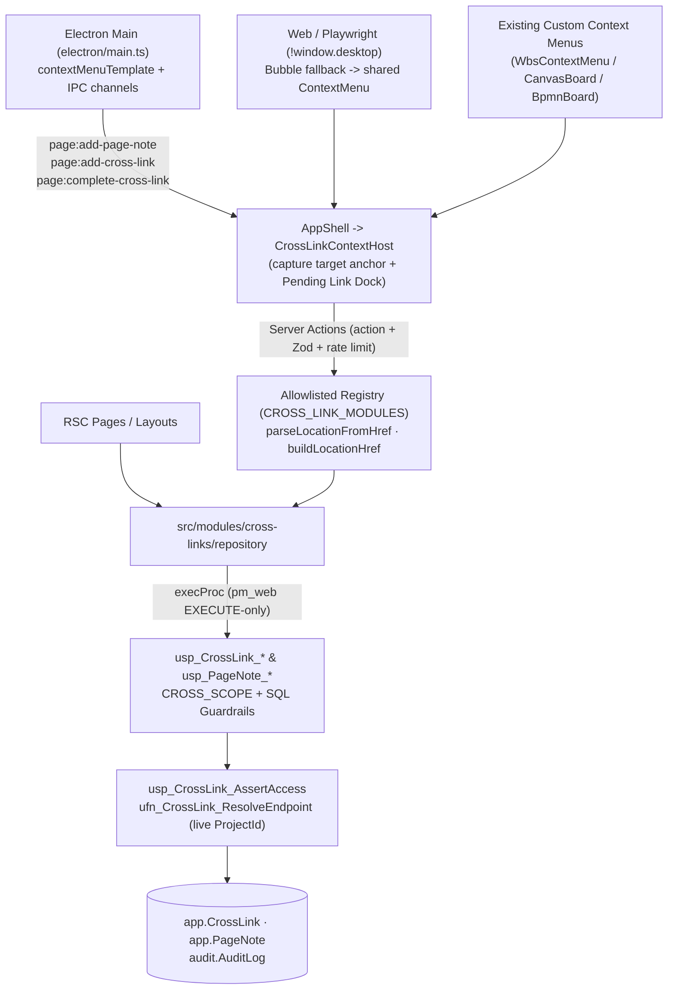

# ADR-0074: 1-to-1 Cross-Links ("Portals") and Small Page Notes

- Status: Accepted (USER approved 2026-11-27)
- Date: 2026-11-27
- Modules: `cross-links` (new), `shell`, `electron`, `projects`, `boards`, `notes`, `todo-items`, `daily-activities`, `key-deliverables`, `requirements`, `bpmn`
- Builds on: ADR-0001, ADR-0002, ADR-0003, ADR-0011, ADR-0012, ADR-0021, ADR-0024, ADR-0031, ADR-0033, ADR-0038, ADR-0040, ADR-0049, ADR-0068

## 1. Context

Users work across many project sections (WBS deliverables, Requirements, Decisions, Risks, Meetings, Financials, Kanban/Scrum Boards, Notebooks) and cross-project views (Dashboard, To-dos, Daily activities, shared Notes/Boards). Client feedback (`V19`) requested two lightweight annotation and navigation tools triggered **strictly from the right-click context menu** (with **no toolbar button**):

1. **1-to-1 Cross-links ("portal" links):** Right-click anywhere to pair two distinct places 1-to-1 across any module and any project, rendered like a compact sticky note; clicking at either end transports the user directly to the paired end and back. A single place may hold many distinct 1-to-1 links.
2. **Small page notes:** Right-click anywhere to attach a small sticky-note memo to the page, section, or record.

Key constraints and risks identified in codebase inspection:
- **Electron native menu preservation (`ADR-0049`):** `electron/main.ts` uses `webContents.on("context-menu")` (`contextMenuTemplate` in `electron/context-menu.ts`) to provide spellcheck suggestions, Add to dictionary, Harper grammar fixes, Cut/Copy/Paste, Copy link, Save (`Ctrl+S`), Print…, and Save page as PDF…. A naive global `event.preventDefault()` in the renderer would suppress and break Electron's native menu; conversely, an Electron-only menu would leave Web/Playwright browsers without right-click access. Existing custom React menus (`WbsContextMenu`, Requirements `CanvasBoard`, `BpmnBoard`, Excalidraw `WhiteboardCanvas`) must also stay intact.
- **Responsive and print layout safety:** Viewport `(x, y)` coordinates break across `375px`–`1920px` screens, sidebar rail collapse (`AppShell`), table sorting/filtering/pagination, zoom/pan canvases, and `@media print` A4 page layouts.
- **URL and XSS safety:** Storing raw URLs or HTML invites open redirects, `javascript:` URIs, and stored XSS.
- **Cross-project access & live-project moves (`ADR-0021`, `ADR-0040`):** Records in `app.Board` (`usp_Board_SetProject`), `app.TodoItem` (`usp_TodoItem_Update`), and `app.DailyActivity` (`usp_DailyActivity_Update`) can move between projects or standalone (`NULL`) after creation, while `app.TodoItem` and `app.Board` also enforce row-creator ownership rules (`ufn_TodoItem_AccessLevel`, `ufn_Board_AccessLevel`). Caching an endpoint's `ProjectId` at link creation without re-resolving the live row would create a stale-project BOLA bypass and broken navigation. Furthermore, `app.Project` supports soft deletion (`IsDeleted = 0`) only — there is no `IsArchived` column.

## 2. Architecture Overview

## 3. Decision

### 3.1 Separate 1-to-1 Pair Table (`app.CrossLink`) and Note Table (`app.PageNote`)
- **`app.CrossLink`** stores each 1-to-1 portal as **one row** holding End A (`EndAModule`, `EndAProjectId`, `EndAEntityId`, `EndASubEntityId`, `EndAAnchorKind`, `EndAAnchorKey`, `EndALabel`) and End B (`EndB*`), plus `LinkTitle` (`NVARCHAR(120)`), optional `NoteText` (`NVARCHAR(500)`), `Color` (`yellow` default), soft delete (`IsDeleted`, `DeletedAtUtc`, `DeletedBy`), `Created*`/`Updated*`, and `RowVer`.
  - Storing both ends on one row makes the **1-to-1 pair invariant structural** (`NOT NULL` endpoints, table-level `CK_CrossLink_DistinctEnds` forbidding self-links, atomic soft-delete and `RowVer` check).
  - Filtered indexes on `(EndAModule, EndAProjectId, EndAEntityId) WHERE IsDeleted = 0` and `(EndBModule, EndBProjectId, EndBEntityId) WHERE IsDeleted = 0` support fast bidirectional lookups via `UNION ALL` / dual-branch queries.
- **`app.PageNote`** stores single-location sticky notes (`ModuleKey`, `ProjectId`, `EntityId`, `SubEntityId`, `AnchorKind`, `AnchorKey`, `AnchorLabel`, `Body NVARCHAR(1000)`, `Color`, soft-delete, audit, `RowVer`).
- **Caps & plain-text invariant:** Both tables reject HTML; inputs are plain text, trimmed, length-capped (`120`/`500`/`1000`), and rendered strictly as React text nodes (never `dangerouslySetInnerHTML`). Write procs enforce per-location caps (`25` cross-links, `20` page notes) and per-project caps (`500` each) under ordered `sp_getapplock` (`MIN/MAX` project ID order prevents cross-project deadlocks). Caps count only live rows of the acting creator: one user's rows never block another user's, and deleted or orphaned rows do not use up a slot. List procs cap reads at `TOP (200)`.

### 3.2 Allowlisted Route Builder (Zero Raw URLs)
- All valid linkable screens live in one canonical closed registry `CROSS_LINK_MODULES` (`src/modules/cross-links/schemas/location.ts`) covering `(app)` work modules and explicitly excluding auth (`/login`, `/change-password`), dev (`/kitchen-sink`), and admin config (`/settings/*`).
- Database rows store `(ModuleKey, ProjectId, EntityId, SubEntityId, AnchorKind, AnchorKey)` — **never raw URLs**.
- `buildLocationHref(location, liveProjectId)` validates `moduleKey` against `CROSS_LINK_MODULES`, validates IDs as positive integers, validates `anchorKey` against `^[a-z0-9:_-]{1,80}$`, and constructs safe relative Next.js paths (`/...`).
- Shared-or-project entities (`board`, `note`, `todo`, `daily-activity`) each use **one canonical `moduleKey`** regardless of `ProjectId` nullability, so `buildLocationHref()` using SQL-resolved `liveProjectId` automatically heals links when an entity moves between projects or standalone (`usp_Board_SetProject`, `usp_TodoItem_Update`, `usp_DailyActivity_Update`).

### 3.3 Responsive & Print-Safe Semantic Anchors (No Raw Pixels)
- **No `clientX`/`clientY` coordinates are persisted.** Right-click walks up from `event.target` to read semantic `[data-cl-anchor]` attributes (row ID, WBS ID, canvas node, meeting section, card key) or falls back to `{ anchorKind: "page", anchorKey: null }`.
- Anchored chips render inline inside dedicated `[data-cl-slot]` badges on records/sections; page-level annotations and any record-anchored items whose target is currently paginated, filtered out, or collapsed render in a responsive **Page Stickies Strip** (`flex-wrap`) below the page header.
- Portal chips and floating/sticky overlays default to `print:hidden` (`src/app/globals.css`) so A4 printouts remain intact.
- A checklist item row anchors with the checklist as entity and the item as sub-entity (anchor kind `subrecord`).
- A deliverables-canvas node uses the anchor key `requirement:<id>` or `wbs:<id>`. A sub-entity is accepted only when the key is `requirement:<sub-entity id>` and that requirement is live in the same project; any other pairing, including a `wbs:<id>` key with a requirement sub-entity, raises `50001`.

### 3.4 Dual Electron IPC + Web Context-Menu Contract
- **Electron Desktop:**
  - `CrossLinkContextHost` (mounted inside `AppShell`, alongside `SaveWorkShortcut` in `src/components/shell/save-work-shortcut.tsx`) listens on `contextmenu` in capture phase, stores `lastRightClickRef` (resolved `LocationAnchor` + point), and writes a 4-field boolean/short-label hint to `document.documentElement.dataset.pmContextMenu` — **without calling `preventDefault()`**.
  - `electron/main.ts` (`showContextMenu`, when `isAppPage(contents)` and `!params.isEditable`) reads that hint and passes `pageExtras` to `contextMenuTemplate()` (`electron/context-menu.ts`).
  - Clicking `"Add cross-link here…"`, `"Complete cross-link…"`, or `"Add page note…"` sends empty-payload IPC signals (`page:add-cross-link`, `page:complete-cross-link`, `page:add-page-note` in `electron/ipc-channels.ts` & `electron/preload.ts`) to the renderer, which executes authenticated Server Actions. All existing spellcheck, grammar, Copy, Copy link, Save, Print…, and Save page as PDF… items stay untouched.
- **Web / Playwright (`!window.desktop`):**
  - A bubble-phase listener on `<main>` fires **only** when `!event.defaultPrevented`, `!event.shiftKey`, `!isEditableTarget(event.target)`, no non-empty text selection exists, and the target is not a direct `<a href>` (or handled cleanly), opening the shared `<ContextMenu>` (`src/components/ui/context-menu.tsx`).
  - Existing custom-menu components (`WbsContextMenu`, Requirements `CanvasBoard`, `BpmnBoard`) integrate cross-link/note items natively into their menus; `WhiteboardCanvas` (Excalidraw) preserves Excalidraw's canvas menu and supports page-level right-click on the workspace shell/strip.
  - Keyboard accessibility (`Shift+F10` / `ContextMenu` key via `isMenuKey`) is supported across `[data-cl-anchor]` elements in both runtimes.

### 3.5 Access Control, Live-Project Resolution & ADR-0040 Non-Disclosure
- Register `"cross-links"` and `"page-notes"` in `CONTRIBUTOR_WRITE_MODULES` and `OVERRIDABLE_MODULES` (`src/lib/auth/rbac.ts`), plus `usp_ProjectPermission_Set.sql`.
- **Live-Project Resolution (`ufn_CrossLink_ResolveEndpoint` + `usp_CrossLink_AssertAccess`):**
  - Every proc resolves the target's live `Entity` (`IsDeleted = 0`), live `ProjectId`, and live `app.Project.IsDeleted = 0` directly from the owning table (`app.Board`, `app.TodoItem`, `app.DailyActivity`, `app.Note`, etc.). Stored `End*ProjectId` is never trusted for access control.
  - Access delegates to each entity's true rule: `ufn_TodoItem_AccessLevel` for `todo`, `ufn_Board_AccessLevel` for `board`, and `ufn_AccessLevel_Resolve` + `usp_Permission_Require` for all other modules.
- **ADR-0040 Existence-Oracle Non-Disclosure:**
  - `usp_CrossLink_ListForLocation` returns only the actor's own rows, and a row **only** when **both** live ends exist (`IsDeleted = 0`, `p.IsDeleted = 0`) and the actor has `Viewer+` read access on **both** ends; otherwise the row is completely omitted (zero count or label leak).
  - Whenever an actor has `@Level IS NULL` (not a member / no access) on either end in `GetById`, `Create`, `Update`, or `Delete`, or either end/project is missing/deleted, the proc throws **`50001 NOT_FOUND`** identically (preventing ID enumeration across hidden projects), except for the creator's orphan delete below. Another user's link or note raises `50001` for everyone, `Admin` included. `50003 FORBIDDEN_ROW` is returned only to a project member lacking the required role/override (`Viewer` attempting `Create`/`Update` on a project page).
- **Access policy: links and notes are personal (USER, 2026-11-27, replaces the shared model in §7.2 and §7.3).** "links are personal, not shared or controlled by anyone else. only the person who created them"
  - Every cross-link and page note, on every page, is visible to and managed by its creator only (`CreatedBy = @ActorUserId`). There is no `Admin` or `Manager` override.
  - **Read:** the creator, with `Viewer+` on every live end (or on the note's live location).
  - **Create / Update Cross-Link:** `Contributor+` (`cross-links:create` / `cross-links:update`) on **both** live ends.
  - **Delete Cross-Link:** the creator, with `Viewer+` on every live end. The creator can also delete an orphan (an end whose record or project is gone). An end that is still live but unreadable to the creator raises `50001`.
  - **Page Notes:** `Contributor` create/update on project pages; on global and personal pages the user needs no project role. The creator deletes with read access to the location, so a `Contributor` can delete their own note; orphaned notes follow the same rule as orphaned links.
  - **Known gap:** the list procs hide orphans, so the UI gives a creator no way to find an orphan and delete it. They stay hidden; they take no cap slot.
- **Guardrails & Testing:** Register `cross-link` and `page-note` in `src/tests/proc-access-levels.test.ts` (including explicit **`CROSS_SCOPE`** entries on `usp_CrossLink_{GetById,Create,Update,Delete}`), add `cross-link-sql-guardrails.test.ts` and `page-note-sql-guardrails.test.ts`, pass `licence: "read"` on all read actions (`licence-write-guard.test.ts`), and add `db/tests/cross-links-procs.cjs` to CI (`db-tests-are-run.test.ts`).

## 4. Consequences & Trade-offs

- **Positive:** Strict 1-to-1 structural integrity in SQL; zero raw URLs or pixel coordinates; Electron's praised spelling/grammar/PDF right-click menu stays 100% intact; BOLA across project moves (`usp_Board_SetProject`, `usp_TodoItem_Update`, `usp_DailyActivity_Update`) is eliminated by live SQL resolution; ADR-0040 prevents cross-project existence enumeration.
- **Negative / Cost:** Adding a new future linkable module requires one registry entry in `CROSS_LINK_MODULES` plus one `WHEN` arm in `ufn_CrossLink_ResolveEndpoint` + CHECK constraint update. Mutual-write on Create means a `Viewer` on Project B cannot create a bidirectional portal into Project B (must use a `PageNote` on Project A or ask for a `cross-links:create` override).
- **Neutral:** Cross-link portals and page notes hide in `@media print` by default; Excalidraw retains its internal canvas context menu, limiting whiteboard annotations to the workspace shell/strip unless Excalidraw options are extended later.

## 5. Security Threat Model Summary

| Threat / Vector | Control & Enforcement Layer | Verification |
|---|---|---|
| **Cross-project BOLA / stale `ProjectId` move** | `ufn_CrossLink_ResolveEndpoint` resolves live entity + live `ProjectId` + `p.IsDeleted = 0`; delegates `todo`/`board` to `ufn_TodoItem_AccessLevel` / `ufn_Board_AccessLevel`. | `db/tests/cross-links-procs.cjs`: move board/todo to restricted project -> immediate omission & `50001`. |
| **Existence oracle (`ADR-0040`)** | `@Level IS NULL` on either end collapses to `50001 NOT_FOUND` identically to absent/deleted rows; lists omit unreadable pairs completely. | Proc & action BOLA tests: probing foreign project/entity IDs yields identical `NOT_FOUND`. |
| **XSS / Open Redirect via link target or text** | No URL strings stored; `buildLocationHref` builds relative paths from allowlisted `moduleKey` + positive ints; plain text only in JSX text nodes. | Unit tests rejecting non-allowlisted keys, `javascript:`, HTML tags, and oversized payloads. |
| **Electron IPC privilege escalation** | Main->Renderer channels send empty trigger signals only; capabilities checked server-side in `action()` + SQL procs. | `electron/tests/proofing.test.ts` + action RBAC unit tests. |
| **Flooding / Lock deadlock** | Per-creator live caps, per anchor (`25`/`20`) and per project (`500`), under ordered `sp_getapplock`; per-user throttle (`ADR-0031`); `TOP (200)` list limit. | Proc tests for limit (`50007`) and concurrent link creation. |

## 6. Slice Implementation Plan (Post-Approval)

1. **Slice 1 (DB + Guardrails):** Migration `097+`, `db/procs/{cross-link,page-note}/*`, `rbac.ts` + `usp_ProjectPermission_Set.sql`, `proc-access-levels.test.ts` (`CROSS_SCOPE`), SQL guardrails, `db/tests/cross-links-procs.cjs` + CI wiring, deployed on `ProjectManager_t1028`.
2. **Slice 2 (Backend & Contracts):** `src/modules/cross-links/{schemas,repository,actions}`, `messages.ts` (`crossLinks`), unit + BOLA/route-builder/licence-guard/messages-tone tests.
3. **Slice 3 (Dual Context Menu + Page Notes UI + E2E):** Electron IPC/menu updates (`proofing.test.ts`), `CrossLinkContextHost`, `PageStickiesStrip`, module menu hooks, E2E in `e2e/cross-links.spec.ts` (registered in `playwright.config.ts`).
4. **Slice 4 (1-to-1 Cross-Links UI + Cross-Window Pending Dock + E2E):** Two-step portal dock (`sessionStorage` + `BroadcastChannel`), portal sticky chips, arrival scroll/highlight, full E2E suite (executed in Packet 7).

## 7. Approved Decisions (USER, 2026-11-27)

1. **Cross-link Create (`Manager`/`Contributor` on Project A + `Viewer` on Project B) — Option A:** Require `Contributor+` (`cross-links:create`) on **both** ends (preserves `Viewer = read-only` on Project B; a user who only views Project B can still place a Page Note in Project A).
2. **Cross-link Delete (superseded the same day by the personal-links rule in §3.5) — Option A:** Require `Viewer+` on both live ends and `Manager` (`cross-links:delete`) on **either** live end (lets a Project Manager remove unwanted portals from their project).
3. **Global-page Page Notes (`/`, `/reports`, `/todo`, `/daily-activities` list; the team-shared part is superseded the same day by the personal-links rule in §3.5) — Option A:** Private to their creator (`CreatedBy = @ActorUserId`) on global/personal pages; team-shared inside projects, `/notes/[id]`, and `/boards/[id]`.
4. **Two-step portal creation — Option A:** Navigate anywhere and right-click `"Complete cross-link"` via a compact persistent dock (with an optional quick-picker helper inside the dock).
5. **Printing (`@media print`) — Option A:** Hide both cross-link portals and floating/page notes (`print:hidden`) so formal A4 printouts stay clean.
